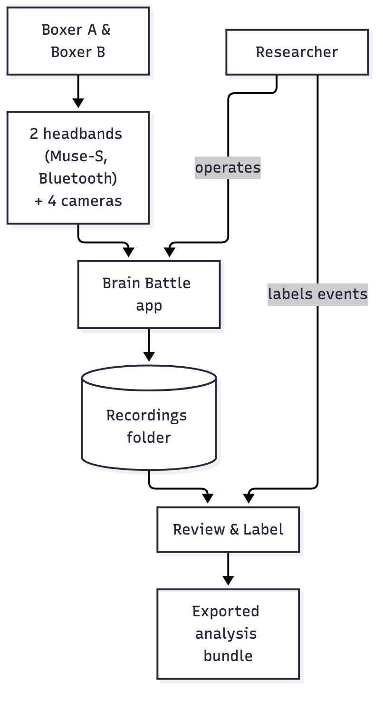

# Writing Brain Battle's documentation

**What this page covers:** the overall plan for `docs/`, the folder structure,
and the style rules every page follows. Read this before writing or editing
any page — it's the contract that keeps the docs consistent as more of them
get written across steps D1–D3.

## Who this is for

Two audiences, one set of docs:

- **Everyone** who uses the app (researchers, research assistants) — the
  *Getting started* and *User guide* sections.
- **Developers and successors** (including students who inherit this project)
  who need to understand, run, test, and extend the code — *Research & data*,
  *Developer guide*, *Decisions*, and *Project*.

The docs are **detailed and technical where that's the point, but written so a
newcomer can follow them**: plain language first, then the precise detail
underneath it. No page assumes you've read every other page first, but pages
link to each other instead of repeating themselves.

## Where the docs live

Plain Markdown under `docs/`, rendered three ways:

1. **GitHub** — the repo's normal Markdown rendering. Nothing special needed.
2. **Inside the app** — a *Documentation* tab (`docs_tab.py`) reads the same
   files at runtime and renders them with Qt's built-in Markdown support (no
   browser engine, no bundled web assets).
3. Nowhere else — **no separate website, no hosting, no build step** that
   produces anything other than pre-rendered diagram images.

### Folder structure

```
docs/
  nav.yml                    # the menu: which pages exist, what order, titles
  getting-started/           # 1. Getting started
  user-guide/                # 2. User guide
  research-and-data/         # 3. Research & data            (D2)
  developer-guide/           # 4. Developer guide             (D3)
  decisions/                 # 5. Decisions (ADRs)            (D3)
  project/                   # 6. Project                     (D3)
  diagrams/                  # Mermaid sources (.mmd) + rendered (.svg)
  images/                    # screenshots referenced by pages (small PNGs)
  contributing/
    docs-guide.md            # this page
  DESIGN.md                  # existing — UI source of truth, stays where it is
  ROADMAP.md                 # existing — build plan, stays where it is
  PLAYBACK_PROPOSAL.md       # existing — stays where it is
  ARCHITECTURE_AND_EVALUATION.md   # existing — stays where it is
```

`DESIGN.md`, `ROADMAP.md`, `PLAYBACK_PROPOSAL.md`, and
`ARCHITECTURE_AND_EVALUATION.md` are **not moved**. The sections below link to
them from the relevant pages instead of duplicating their content.

### `docs/nav.yml`

The single source of truth for the Documentation tab's menu, and for what's
"published" at all:

```yaml
sections:
  - title: Getting started
    pages:
      - id: overview
        title: Overview
        file: getting-started/overview.md
      # ...
```

**Only finished pages go in `nav.yml`.** A page can exist as a `.md` file
mid-draft without being linked anywhere — the app only ever shows what's
listed, so there is never an empty or "coming soon" page inside the product
(the placeholder gate in `tests/test_no_placeholders.py` keeps guarding the
app's own UI strings; see "Scope of the placeholder gate" below for how the
two relate). Add a page to `nav.yml` in the same commit that finishes it.

## The six sections (Diátaxis + ADRs)

Brain Battle's docs follow the [Diátaxis](https://diataxis.fr/) framework —
docs split by what the reader is trying to do, not by what the software
happens to contain — plus a dedicated section for Architecture Decision
Records (ADRs). Six sections, each with a distinct job:

| # | Section | Diátaxis type | Job | Step |
|---|---|---|---|---|
| 1 | **Getting started** | Tutorial | Get a new reader from zero to a working app, hands held | D1 |
| 2 | **User guide** | How-to | Look up how to do one specific thing in the app | D1 |
| 3 | **Research & data** | Reference | Look up an exact file format, column, or timing guarantee | D2 |
| 4 | **Developer guide** | Reference + explanation | Understand the architecture and extend the code | D3 |
| 5 | **Decisions** | Explanation (ADRs) | Understand *why* something is built the way it is | D3 |
| 6 | **Project** | Explanation | Orient a newcomer in the project's history and direction | D3 |

### 1. Getting started (tutorial — D1)

A straight line from "I just cloned this" to "the app is open and I
understand the three screens." Numbered, no branching, no options to choose.

- **Overview** — what Brain Battle is, who uses it, the three screens
  (Sessions, New recording, Review & Label), a context diagram.
- **Installation** — macOS first (the primary dev platform), Windows notes;
  Python + `requirements.txt` + ffmpeg; a verify step.
- **First run** — the empty Sessions screen, where recordings are saved, what
  to check in Settings first.
- **Quick tour** — one screenshot per screen, two lines each.

### 2. User guide (how-to — D1)

One page per screen/task. A reader lands here from a specific question
("how do I mark a moment during recording?"), not to read start to finish.

Pages: Sessions · New recording · Review & Label · Export for analysis ·
Settings · Troubleshooting · FAQ.

### 3. Research & data (reference — D2)

For the person who needs to *load the data*, not operate the app: recording
folder anatomy, every file format (manifest, `phase_markers.csv`, camera
sidecars, EEG CSVs, contact log, `labels.json` v2, `label_list.json`,
`history.jsonl`, the export zip), the timing & accuracy model (what "aligned"
actually means and to what tolerance), loading data in Python/R, and a list of
what is and isn't verified yet.

### 4. Developer guide (reference + explanation — D3)

For the next person who opens this codebase: architecture (context/
container/component diagrams), a reference entry per module, the key flows as
sequence diagrams (recording start→stop, crash recovery, open-in-review,
playback clock, label placement + autosave, export), the threading model, the
design system/UI conventions, testing strategy, simulation mode + the demo
generator, coding conventions + git workflow, how-to-extend recipes, and known
issues/tech debt.

### 5. Decisions (ADRs — D3)

One file per decision, [Michael Nygard's
format](https://cognitect.com/blog/2011/11/15/documenting-architecture-decisions):
**Context** (the forces at play), **Decision** (what we chose), **Consequences**
(what that costs or enables), **Status** (proposed / accepted / superseded —
most of these are already-made decisions being written up after the fact, so
most start at "Accepted"). Planned ADRs: the capture-time clock, removing
audio cross-correlation sync, crash-safe fragmented H.264 via ffmpeg, PyAV
app-driven playback, light-only design, the labels v2 schema, date-named
recording folders, the settings store, simulated devices.

### 6. Project (explanation — D3)

Goals & research context, current status, a link to `ROADMAP.md` (not a
duplicate of it), changelog/version history, and a glossary (the plain-
language term on one side, the internal/technical name on the other — the
same mapping `DESIGN.md`'s Vocabulary section already uses for the UI,
extended with terms that only show up in code/docs).

## Style rules

Every page in every section follows these, no exceptions:

1. **Plain language first, then detail.** Open with what a non-technical
   reader needs; the precise technical statement follows, not instead.
2. **Every page starts with a "What this page covers" line** — two or three
   sentences right under the title, so a reader can bail in five seconds if
   it's the wrong page. (You're reading one right now.)
3. **One idea per section.** If a section needs "and also," it's two
   sections.
4. **Numbered steps for procedures.** Anything the reader does in order gets
   a numbered list, not prose paragraphs describing the order.
5. **Tables for reference material.** Columns, file formats, keyboard
   shortcuts, troubleshooting symptom→cause→fix — always a table, never a
   bulleted wall of key: value pairs.
6. **A diagram wherever a process has more than 3 steps.** Mermaid source
   under `docs/diagrams/*.mmd`, rendered to `*.svg` next to it (see
   "Diagrams" below) — never an unrendered Mermaid code fence (GitHub renders
   those, but the in-app tab does not run a Mermaid engine).
7. **Every technical claim is verified against the code**, and cites the
   module/function it came from (e.g. "per `session_storage.disk_space_verdict`").
   Don't describe what the code *should* do from memory — open the file and
   check, the same way `CLAUDE.md`'s own conventions demand for the app
   itself.
8. **Anything not confirmed on real hardware is labelled "Not yet verified on
   hardware."** Brain Battle's hardware is currently broken (see
   `CLAUDE.md`'s "Project situation") and built/tested against the generated
   demo session and simulated devices — the docs must not imply something was
   watched on real cameras/headbands when it wasn't. Use the exact phrase so
   it's greppable.

## Diagrams

Mermaid source lives at `docs/diagrams/<name>.mmd`. Render it with:

```bash
python3 tools/render_diagrams.py
```

This shells out to `npx @mermaid-js/mermaid-cli` (no global npm install — npx
fetches/caches the package itself) and writes, next to each `.mmd`:

- `<name>.svg` — the full-fidelity Mermaid output, committed for GitHub (which
  runs a real browser-grade SVG+CSS renderer) and as the zoomable source of
  record.
- `<name>.png` — a raster of the *same* render, committed because this is
  what **Markdown actually references** (see "Why PNG, not SVG, in Markdown"
  below).
- `<name>.hash` — sha256 of the `.mmd` source, so staleness is detectable
  without relying on filesystem mtimes (`tests/test_docs.py` fails if a
  `.mmd` changed without re-running this).

**Commit the `.mmd`, `.svg`, `.png`, and `.hash` together.** Reference the
PNG from Markdown with a normal image link:

```markdown

```

### Why PNG, not SVG, in Markdown

The original plan was SVG everywhere. In practice, the in-app Documentation
tab renders Markdown with Qt's `QTextDocument`/`QTextBrowser` (no
QtWebEngine), which loads images through `QtSvg`'s `QSvgRenderer` — a small,
old subset of SVG+CSS. Verified empirically against this project's own
diagrams: Mermaid's SVG output relies on two things that subset doesn't
support —

1. Shape colours come from an embedded `<style>` block with class selectors
   (`.node rect { fill: ...; }`); `QSvgRenderer` only honours inline
   `style=`/presentation attributes, so every shape rendered with the SVG
   default (solid black) fill.
2. Node labels are `<foreignObject><span>text</span></foreignObject>`;
   `QSvgRenderer` doesn't implement `foreignObject` at all, so every label
   rendered as an empty box.

Forcing Mermaid into plain SVG text (`htmlLabels: false`) and inlining the
stylesheet with `svgo`'s `inlineStyles` plugin fixes both *technically*, but
introduces a third, cosmetic bug in this Mermaid version's non-HTML text
layout (word-wrap silently drops the space at a line's wrap point on longer
labels). Rather than hand-tuning every label to dodge a renderer quirk, both
outputs now come from the same Chromium-via-puppeteer render mermaid-cli
already does for you — the PNG is pixel-faithful to what Mermaid intends, and
`QImage`/`QPixmap` already load PNG natively with zero special-casing. GitHub
still gets the full `.svg` for zoomable viewing; the app gets the `.png`.

### Diagram size (must stay readable in the app)

The in-app Documentation tab scales every image down to the reading column
(~720 px at most; narrower on a small window — see "Reading column &
typography" below). A diagram that's wide on screen gets scaled down a lot,
and its label text shrinks with it. So keep diagrams **narrow**:

- **Declare a base font size** in the diagram's init directive so its on-screen
  size is predictable: `%%{init: {'themeVariables': {'fontSize': '16px'}}}%%`.
- **Keep the rendered width small.** Displayed label size ≈
  `fontSize × 720 / svg-viewBox-width`. For 16 px labels to display at ≥ 12 px,
  the SVG viewBox must be ≤ ~960 px wide. `tests/test_docs.py`
  (`test_diagram_text_is_readable`) enforces ≥ 12 px and fails otherwise.
- **Prefer vertical (`flowchart TB`/`TD`) over wide `LR`** layouts, wrap long
  node labels with `<br/>`, and keep edge labels short — all of these keep the
  width down.
- **Split a complex diagram into smaller ones** rather than letting one grow
  wide. One idea per diagram.
- **Don't duplicate a diagram as ASCII.** Show the diagram once (the PNG); a
  prose sentence can introduce it, but don't also paste an ASCII version of
  the same picture.

## Screenshots

Curated, small PNGs under `docs/images/`, generated (not hand-captured) by:

```bash
python3 tools/render_screens.py --docs
```

This drives the app with `BRAIN_BATTLE_SIMULATE=1`, but — unlike the
`screens/` dump used for UI review — docs mode points the app at a cleanly
**named** recordings folder ("Brain Battle Data"), configured as a normal
saved setting (not the `BRAIN_BATTLE_CAPTURE_DIR` override, which would make
Settings show its "set outside the app" note), and fills it with a small demo
**library** so the Sessions image shows several real statuses (Needs
labelling, Labelled, Exported, Interrupted). No throwaway temp-folder name
("…/bb_render_cfg_ab12/…") ever appears in a committed image —
`tests/test_docs.py` (`test_docs_images_have_no_temp_folder_name`) guards
that. It writes a **curated** set of one screenshot per screen at 1280×800
into `docs/images/` with doc-friendly filenames, already scaled down for file
size. Re-run it whenever a screen's layout or copy changes enough that a
screenshot would mislead.

## Reading column & typography

`docs_tab.py` renders Markdown through Qt's `QTextDocument`/`QTextBrowser`,
not a browser, so the reading experience is tuned in code rather than CSS
(Qt's Markdown importer ignores most of a default stylesheet — only inline/
character styling and table borders get through):

- **Vertical rhythm & line height** come from a block-format pass
  (`_apply_typography`): comfortable body size (~15 px), ~1.5 line height, and
  real space above/below headings, paragraphs, list items and tables. It runs
  the same two-pass "collect positions, then mutate" way as the code-run
  styler, to avoid invalidating the block iterator mid-walk.
- **"What this page covers"** is detected and set apart as a light callout box
  (tinted background + padding). Keep that exact phrase at the top of every
  page — it's both the reader's one-line summary and the callout's trigger.
- **Images/diagrams scale to the column** and never force a horizontal
  scrollbar (`_ContentBrowser` rescales them on resize; the horizontal
  scrollbar is disabled). `test_docs.py` (`test_no_horizontal_overflow`)
  checks every page's laid-out width fits the column at all three sizes.
- **Don't nest fenced code blocks inside list items.** Qt won't wrap a code
  block, and a code block indented under a numbered step widens the whole list
  column (and overflows). Put the step as a sentence, then the code block at
  the left margin (see `getting-started/installation.md`).

## Scope of the placeholder gate

`tests/test_no_placeholders.py` scans the app's own Python source (`*.py` at
the repo root + `sync_utils/`) for placeholder UI copy and forbidden jargon in
widget-text calls. It does **not** scan `docs/*.md` — and shouldn't: the docs
(especially the Developer guide, Decisions, and Research & data sections) are
written for developers and necessarily use the technical vocabulary
`DESIGN.md` bans from the *app's* UI (`sync`, `align`, `capture clock`,
`xcorr`, EEG channel codes, etc.). The gate's job is "the product doesn't show
jargon to a non-technical researcher," not "no document anywhere may use a
technical word." The **User guide** (D1) still follows `DESIGN.md`'s plain
vocabulary throughout, because it describes the same screens the gate
protects and should read exactly like them — that's a style choice this guide
makes, not something the test enforces.

## The format reference must match the code

The *Research & data* section documents exact file formats — every manifest
key, CSV column, history event, and export-zip entry. Those tables are only
useful if they can't silently drift from what the code actually writes, so a
test enforces it: `tests/test_research_docs.py`
(`test_*_documented`) generates a **real** recording and a **real** export,
then reads the field names straight back out —

- manifest keys recursively from `session_manifest.json`,
- CSV columns from each file's header (markers, camera sidecars, EEG, contact
  log, co-registered EEG, labels, events),
- `labels.json` / `label_list.json` fields from `labels_store` / `label_vocab`,
- history event types from `session_history.EVENT_*`,
- export-zip entries from the zip's `namelist()` —

and fails unless each one appears, backticked, in
`research-and-data/file-formats.md`. **Add a field to the code without adding it
to that page and the test goes red.** So: when you change a written format, update
the format reference in the same commit. Wrap every field/column/key/event/entry
name in `` `backticks` `` there — that's both the house style and what the test
greps for (grouped spans like `` `{a, b, c}` `` and intentionally-empty spans
are both handled).

The same test runs the *Loading the data* Python examples against a generated
demo export, so those stay executable; the R examples run too when `Rscript` +
`readr`/`dplyr` are present, and are otherwise reported "not automatically
tested".

## Checklist for a new page

1. Pick the right section (see the table above) and write the `.md` file.
2. Start with the title (`# `) and a "What this page covers" line.
3. Verify every concrete claim against the code; add citations.
4. Add any diagrams (`docs/diagrams/*.mmd`, rendered) and screenshots
   (`docs/images/*.png`, generated) it needs.
5. Add it to `docs/nav.yml` under the right section, in reading order.
6. Run `tests/test_docs.py` — it checks the page renders, every image/diagram
   it references exists, every internal link/anchor resolves, and search
   finds at least one phrase from it.
