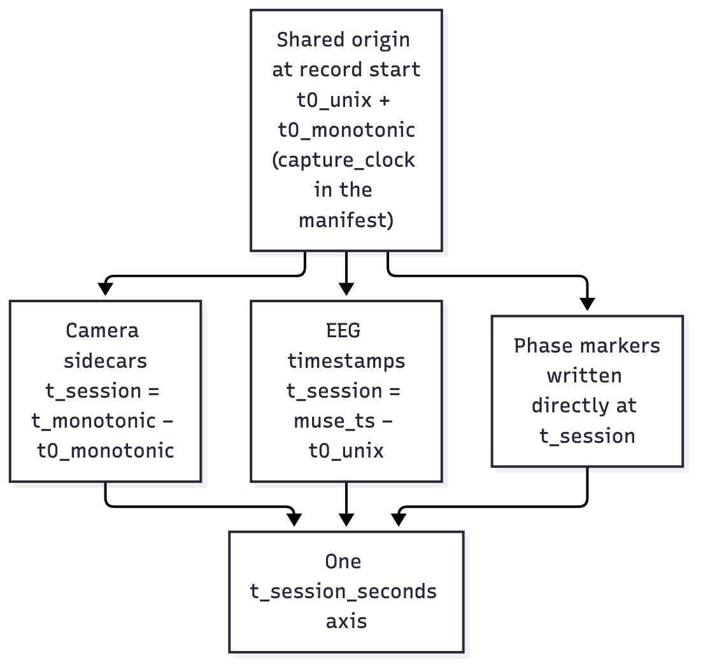

# ADR-0001 — Capture-time clock for alignment

**What this page covers:** why Brain Battle aligns cameras and EEG by stamping
every frame and sample from one software clock at acquisition, rather than
measuring alignment after the fact.

- **Status:** Accepted
- **Date:** 2026-07-07

## Context

The hardware is four independent USB camera streams and two independent
Bluetooth Muse-S streams, with **no shared hardware clock**. The research payload
is between-brain synchrony, which needs the cameras and both EEG bands on **one
comparable timeline**. At the time, there were no per-frame timestamps at all — a
frame's time was inferred as `frame_index / nominal_fps` — and alignment was
*assumed* (sources started "near simultaneously"), not measured. That assumption
breaks the moment a camera's true capture rate drifts from its declared rate.

## Options considered

1. **Real-time 4-camera compositing** into one file — locks cameras together but
   loses the individual angles, still doesn't include EEG, and puts heavy encode
   load on one laptop.
2. **Hardware genlock / timecode** — frame-accurate, but needs new hardware and
   breaks the "no new hardware, free" constraint; over-engineered for tens-of-ms
   synchrony.
3. **Capture-time timestamping** — keep separate files, but stamp every camera
   frame and every EEG sample from one monotonic clock on the laptop at
   acquisition, and align by the recorded timestamps.

The full survey is in
[ARCHITECTURE_AND_EVALUATION.md](../project/planning-documents.md) (Intent A/B,
items I1–I4).

## Decision

Adopt **capture-time timestamping**. At record start, capture one shared origin
`(t0_monotonic, t0_unix)` and thread it into every source. Each camera writes a
per-frame sidecar; the EEG recorder writes a `t_session_seconds` column; phase
markers are written directly on the same axis. Everything lands on one
`t_session_seconds` axis, so alignment becomes a **lookup, not a guess**. The
origin and each source's measured first-sample time are persisted to the manifest
(`capture_clock`, `source_starts`).

Precision target is **tens of ms** (software-clock jitter + BLE latency),
deliberately not sub-ms — no genlock, no LSL.

## Consequences

- **Enables** the merged single-playhead Review & Label screen
  ([ADR-0005](adr-0005-pyav-playback.md)) and a co-registered EEG export: video,
  EEG, and timeline are the same number by construction.
- **Makes 3.0 a breaking change** — pre-3.0 sessions lack this data and are not
  supported; there is no legacy-fallback alignment path.
- **The arithmetic is unit-tested** (`tests/test_capture_clock.py`) but the **EEG
  clock source is Not yet verified on hardware** — muselsl derives timestamps
  from `time.time()` corrected per band, and BLE adds latency, neither confirmable
  without a real band ([ADR-0003](adr-0003-eeg-streamed-to-disk.md) writes it;
  [known limitations](../research-and-data/limitations.md) #0 tracks verifying
  it).
- **Don't chase tighter precision** until whoever owns the synchrony analysis
  confirms it matters.

## Links

- Commit `2e03d49` (align review/label by capture-time stamps).
- [Timing & accuracy](../research-and-data/timing-and-accuracy.md),
  [history.md](../archive/history.md) (STEPs 1–5),
  [ADR-0002](adr-0002-remove-audio-xcorr.md).
