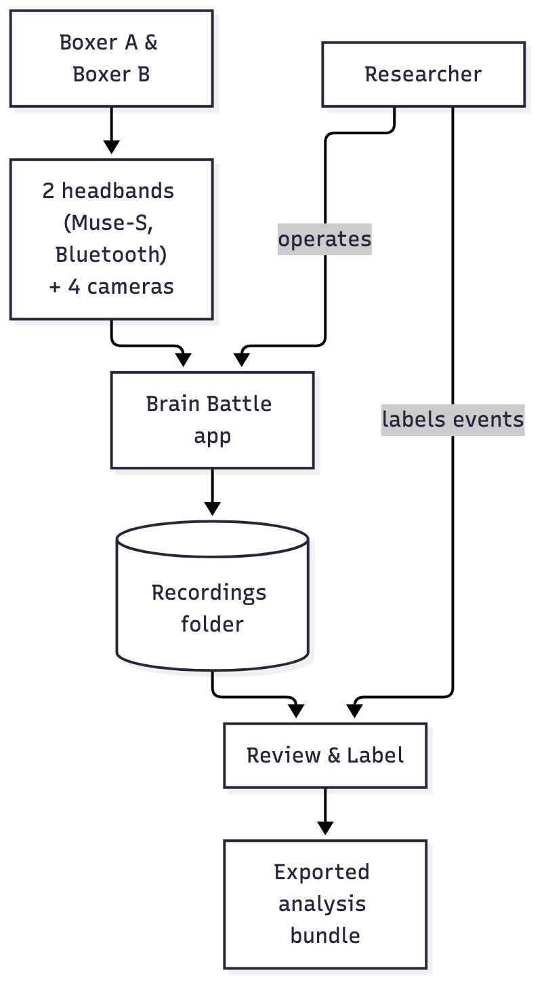
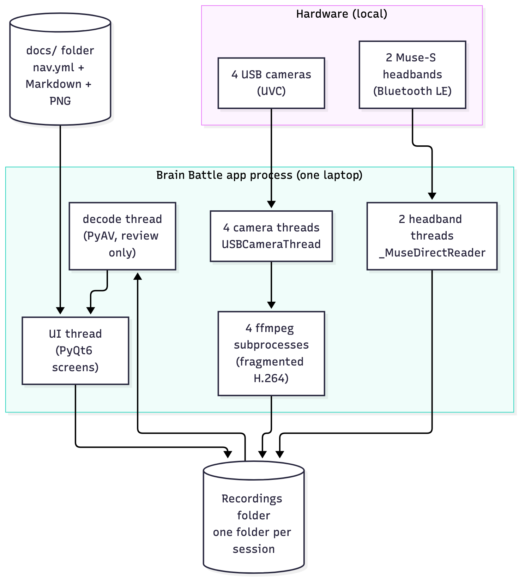

# Architecture overview

**What this page covers:** the shape of the whole app in three zoom levels —
the system in its environment (context), the processes and threads that make it
up (containers), and the modules grouped by job (components). Read this first;
the [module reference](module-reference.md) and [key flows](key-flows.md) drill
into the pieces it names.

Brain Battle is a single PyQt6 desktop application — about 13,000 lines across
31 first-party `.py` files at the repository root. It records a boxing sparring
session from four USB cameras and two Muse-S EEG headbands onto one shared
clock, lets a researcher review and label it afterwards, and exports an
analysis bundle. There is no server, no database, and no network code: a
recording is a self-contained folder on disk.

## Context — the app in its environment

Two boxers wear headbands and are filmed by four cameras. Everything feeds one
app running on one laptop, which writes each session to a recordings folder. A
researcher reviews and labels from that folder and, when ready, exports a
bundle.

The hardware constraint that shapes everything downstream: there are **four
independent USB camera streams and two independent Bluetooth EEG streams, with
no shared hardware clock**. "Record everything together" therefore cannot mean
one hardware-synchronised capture — it means stamping every camera frame and
every EEG sample from one software clock at acquisition and aligning by those
timestamps afterward. That decision is [ADR-0001](../decisions/adr-0001-capture-time-clock.md),
and the [timing & accuracy](../research-and-data/timing-and-accuracy.md) page
explains what it buys and what it doesn't.

## Containers — processes, threads, and subprocesses

Everything the user interacts with lives in **one process on the recording
laptop**. Inside it, work that would block the UI is pushed onto worker threads
and — for video encoding — onto one `ffmpeg` child process per camera.

| Container | What it is | Where |
|---|---|---|
| **UI thread** | Every PyQt6 widget and screen. Must never block (see [threading model](threading-model.md)). | main thread |
| **Camera threads** | One `USBCameraThread` per camera: grab frames, queue them to its encoder. | `usb_camera.py` |
| **ffmpeg subprocesses** | One per camera, fed raw frames over stdin, writing fragmented H.264. | spawned by `usb_camera.FrameEncoder` |
| **Headband threads** | One `_MuseDirectReader` per band: BLE read loop + a CSV-writer thread. | `eeg_module.py` |
| **Decode thread** | `DecodeWorker` (PyAV) during review only — decodes frames off the UI thread. | `pyav_player.py` |
| **Recordings folder** | One folder per session; the only durable state the app keeps. | on disk |
| **`docs/` folder** | Read at runtime by the Documentation screen (`nav.yml` + Markdown + PNGs). | on disk |

The app has no other persistent store. User settings live in one small JSON
file in the OS config directory (`app_settings.py`); the shared label
vocabulary lives in the recordings folder (`label_vocab.py`); everything else
about a session is inside that session's folder.

## Components — modules grouped by job

The 31 modules fall into five groups. UI screens sit on top; capture, playback,
and data/storage do the work; a support layer (settings + design tokens) cuts
across all of them.

| Group | Modules | Job |
|---|---|---|
| **UI screens** | `sidebar_shell`, `sessions_tab`, `record_flow`, `review_label_tab`, `settings_tab`, `docs_tab` | The four DESIGN screens behind a light sidebar shell, plus the in-app docs. |
| **Capture** | `camera_source`, `headband_source`, `usb_camera`, `eeg_module`, `session_controller`, `contact_quality`, `keep_awake`, `contact_log` | Turn live devices into files on disk during a recording. |
| **Playback** | `pyav_player` | App-driven multi-camera decode on one playhead. |
| **Data & storage** | `session_storage`, `labels_store`, `label_vocab`, `session_history`, `export_module` | On-disk layout, labels, the shared vocabulary, the history log, and the export bundle. |
| **Support** | `app_settings`, `design_tokens`, `fonts`, `log_setup`, `version`, `simulation` | Settings, the light-only design system, logging, version, and the dev-only device simulator. |

Each module is documented in the [module reference](module-reference.md); the
main runtime interactions are drawn as [key flows](key-flows.md).

## The three screens (plus two)

The product is **three screens plus Settings**, wired behind a light sidebar
shell (`sidebar_shell.py`), with an in-app Documentation screen (`docs_tab.py`)
added in documentation step D1:

1. **Sessions** (`sessions_tab.py`) — the home library; the app opens here.
2. **New recording** (`record_flow.py`) — a full-screen guided flow: Connect →
   Set up → Record → Saved.
3. **Review & Label** (`review_label_tab.py`) — one merged screen for playback
   and labelling on a single `t_session_seconds` playhead.
4. **Settings** (`settings_tab.py`) — everything that used to be hardcoded.

The source of truth for how these screens look and read is
[`docs/DESIGN.md`](../project/planning-documents.md); the reasoning behind the
*structure* (one merged review screen, light-only, a guided flow) is in the
[Decisions](../decisions/index.md) section.

## Where to go next

- The per-module breakdown: [Module reference](module-reference.md).
- How the pieces interact at runtime: [Key flows](key-flows.md).
- Why threads are arranged the way they are: [Threading model](threading-model.md).
- Why the big structural choices were made: [Decisions (ADRs)](../decisions/index.md).
