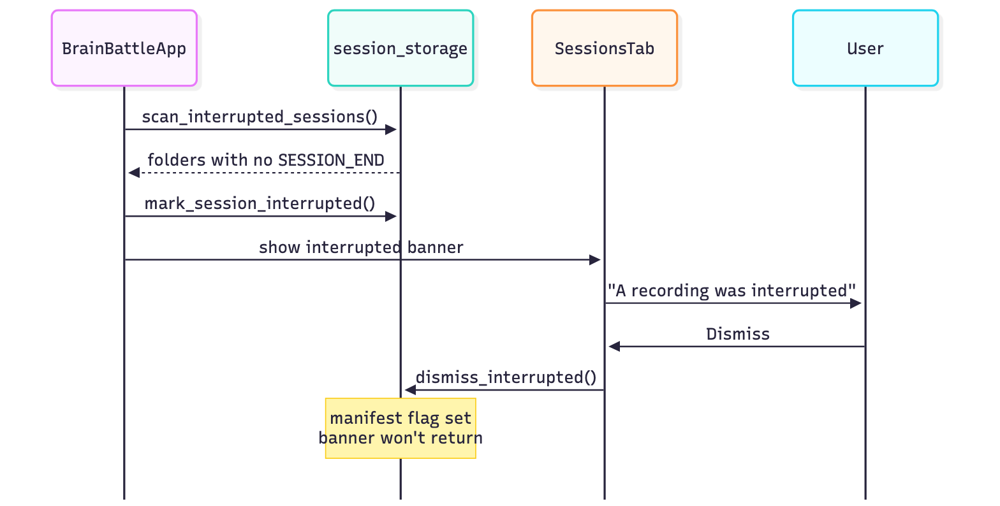
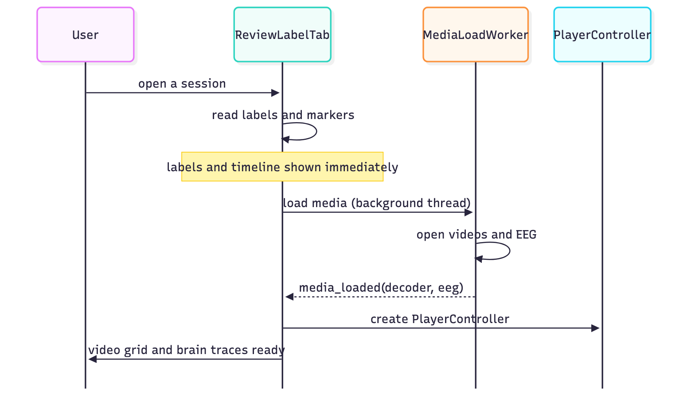
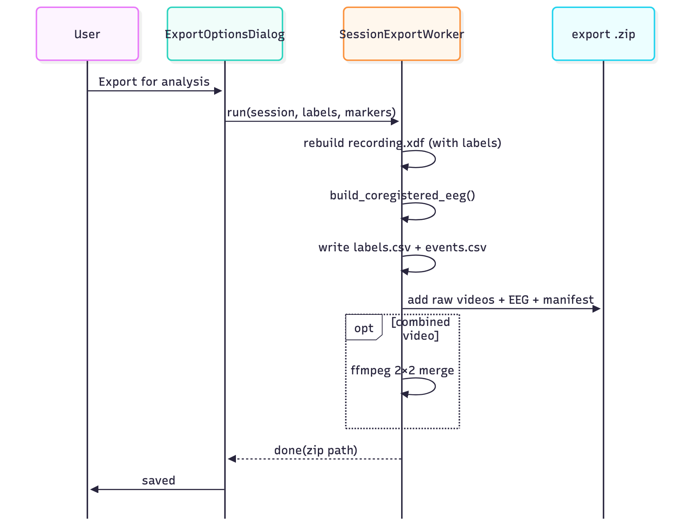
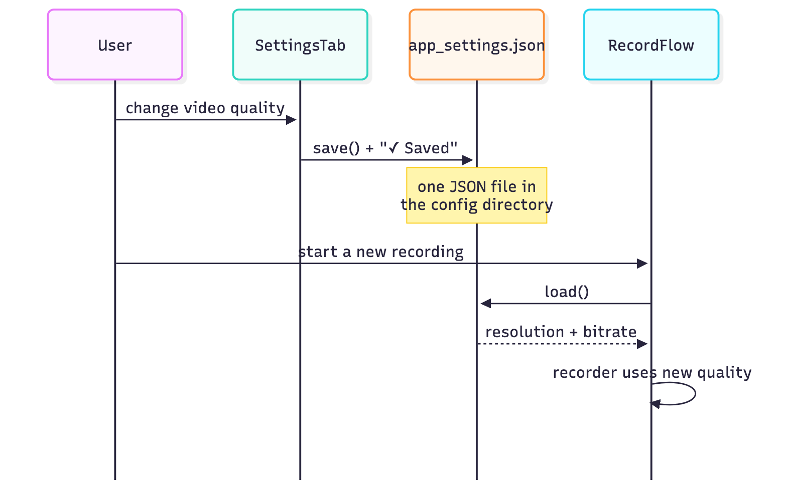

# Key flows

**What this page covers:** the handful of runtime flows worth understanding
before changing anything — each as a sequence diagram with a short walkthrough.
They name the classes in the [module reference](module-reference.md); the
threads they cross are in the [threading model](threading-model.md).

## Recording: start → stop

`RecordFlow` captures one shared origin and threads it into every source, drives
the phase state machine, and turns phase changes into marker rows. Nothing
restarts at a phase boundary — one continuous take per source.

1. `RecordFlow.begin_recording` calls `session_storage.create_session`; when the
   controller starts, `_on_session_started` takes `clock.session_origin()` and
   stores it with `set_capture_origin(t0_monotonic, t0_unix, t0_lsl)` — the
   capture clock ([ADR-0017](../decisions/adr-0017-one-capture-clock.md)).
2. Each `CameraSlot` and `HeadbandSlot` starts recording **with that same
   origin**, so every camera frame and EEG sample lands on one
   `t_session_seconds` axis ([ADR-0001](../decisions/adr-0001-capture-time-clock.md)).
3. `SessionController` runs the `BASELINE→ROUND↔BREAK→DONE` timeline at 1 Hz; on
   each `phase_changed`, `RecordFlow` writes a `phase_markers.csv` row.
4. On finish (or an early stop), sources stop, the manifest is finalised, and
   `history.jsonl` records the recording. `keep_awake` is released.
5. A 150 ms timer then waits until every camera reports
   `recording_finalised` (its video and sidecar are closed) and starts a
   background thread that calls `session_xdf.build_session_xdf` — the
   `recording.xdf` row on the Saved screen turns to a tick when it is done, and
   any camera whose measured frame rate was more than 1 % off is added under
   "Worth checking".

Throughout steps 2–4 the same samples, markers and frame times are also pushed
to the live LSL outlets (`lsl_outlets.LslPublisher`) if sharing is switched on;
that path is fail-soft and nothing above depends on it
([ADR-0015](../decisions/adr-0015-lsl-and-xdf.md)).

## Crash detection → interrupted banner → dismiss

A recording that never wrote `SESSION_END` is treated as interrupted — kept, not
discarded, and surfaced once.

1. On launch, `session_storage.scan_interrupted_sessions` finds folders with
   recorded phases but no `SESSION_END`.
2. Each is flagged `interrupted: true` in its manifest (no fabricated
   `SESSION_END`), so it won't nag again, and `SessionsScreen` shows the banner.
3. **Dismiss** calls `dismiss_interrupted`, persisting the dismissal — the
   banner does not come back. Everything recorded up to the crash is kept and
   still opens in Review.

## Opening a recording in Review & Label

Labels and the timeline appear **immediately**; the heavier media load happens
on a background thread so the screen is usable in well under half a second.

1. `ReviewLabelScreen.load_session_folder` opens the current labeller's labels file (`labels/<labeller>.json`, migrating an old `labels.json` first) and
   `phase_markers.csv` and renders the labels panel and timeline right away.
2. `_MediaLoadWorker` (a QThread) opens the four videos and both EEG files off
   the UI thread.
3. When it signals back, a `pyav_player.PlayerController` is attached and the
   video grid + brain traces come alive. `tests/test_review_tab.py` asserts the
   labels-first open stays fast.

## The playback clock

There is **one clock** — the app's playhead `t`. Every tick derives `t` from the
real monotonic clock, asks the decode worker for the frame-at-`t`, and moves the
EEG and timeline to the same `t`. No per-player clocks, no A/V sync (the videos
have no audio).

1. A ~60 Hz `QTimer` ticks `PlayerController._tick`, which sets
   `t = t0 + speed × (now − wall0)` — so 1× is honest 1× even if decoding is
   slow (frames are skipped, time is not).
2. `PlayerController` calls `DecodeWorker.request(t)`. If requests pile up during
   a scrub, only the **latest** `t` is decoded (seek coalescing) — a flurry of
   scrubs costs a couple of decodes, not one per scrub.
3. `MultiCamDecoder.decode_all(t)` returns the frame-at-`t` for each camera (the
   latest sidecar time ≤ `t`), correct even on the drift camera.
4. `playhead_changed(t)` moves the EEG trace and timeline cursor. Video, EEG, and
   timeline are the same number by construction
   ([ADR-0005](../decisions/adr-0005-pyav-playback.md)).

## Placing a label → autosave → undo

Every label change is persisted immediately and is undoable.

1. A number key (or click) calls `_place_from_vocab`; `ReviewLabelScreen` builds a
   label with `labels_store.new_label` (who A/B/Both, point or duration) and
   `LabelsStore.add`s it. The store records an inverse op for undo.
2. The labeller's file (`labels/<labeller>.json`) is saved atomically — after merging in anything that appeared on disk since it was read — and `history.jsonl` gets an append; the
   header shows "All labels saved".
3. **Undo** (`⌘Z`) replays the inverse op and saves again. Duration labels place
   on the first key press and close on the second (DESIGN §6). See
   [ADR-0006](../decisions/adr-0006-labels-v2.md).

## Export for analysis

Export reads straight from the recording folder and writes a self-contained zip.

1. `ExportOptionsDialog` runs `SessionExportWorker` (a QThread) with the session,
   placed labels, and phase markers.
2. The worker rebuilds `recording.xdf` with the current labels
   (`session_xdf.build_session_xdf`), calls `build_coregistered_eeg` (both bands
   on one 256 Hz axis), writes `labels.csv` (v2) and `events.csv` (labels +
   markers on one timeline), and adds the raw videos (with sidecars), raw EEG and
   sensor CSVs, manifest, history, and a README to the zip.
3. A **combined 2×2 video** is optional and off by default (it's the slow step).
   The result is one self-contained bundle. See
   [export for analysis](../user-guide/export.md) and
   [file formats](../research-and-data/file-formats.md).

## A Settings change reaching the next recording

Settings autosave to one JSON file; the next recording reads it fresh. There is
no "apply" step and no restart.

1. Changing a Settings control autosaves to `app_settings.json` and flashes
   "✓ Saved".
2. The **next** recording's `RecordFlow`/`SetupStep` reads `app_settings` fresh —
   the recorder uses the new resolution + bitrate, the disk estimate and GB/hour
   copy recompute from the new bitrate, and Review & Label reflects any label-list
   change. See [ADR-0010](../decisions/adr-0010-app-settings-store.md).
