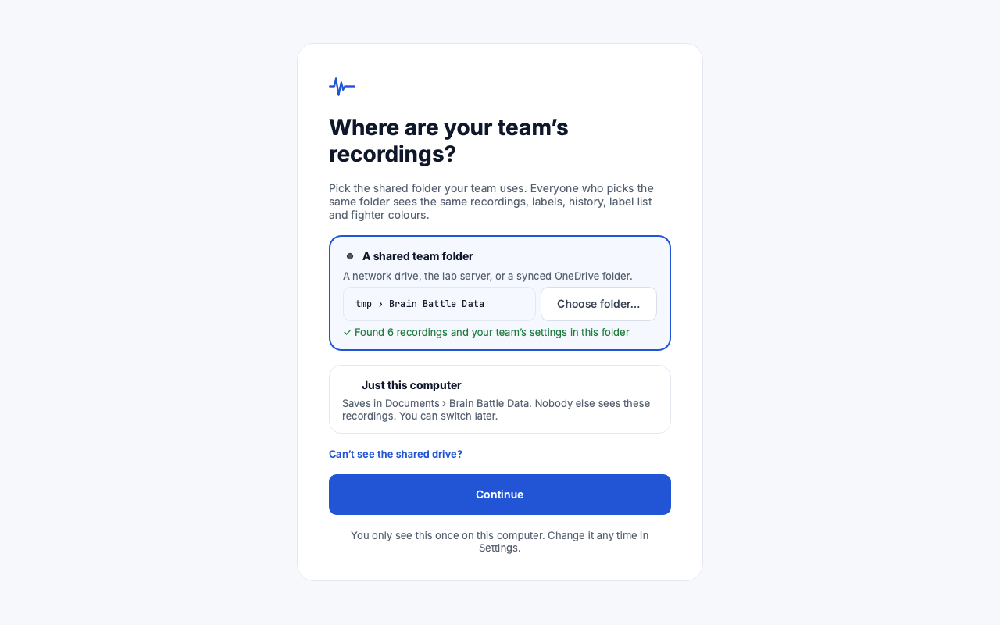

# First run

**What this page covers:** what you'll see the first time you open Brain
Battle, where your recordings are saved, and what to check before your first
real session.

## Where are your team's recordings?



The first time Brain Battle opens on a computer it asks once where the team's
recordings are:

- **A shared team folder** — a folder on a shared drive the whole team uses.
  Press **Choose folder…**; if it already holds recordings the screen says so
  ("✓ Found 5 recordings and your team's settings in this folder"), and you get
  the team's label list and fighter colours with them. **Can't see the shared
  drive?** explains how to connect it on this computer.
- **Just this computer** — **Documents › Brain Battle Data**.

Press **Continue**. You can change it later in
[Settings](../user-guide/settings.md).

## The Sessions screen

The app then opens on **Sessions**. On a fresh folder it is empty — "No
recordings yet" — until you record something. The big blue **New recording**
button is at the top.

## Your name

Labels you place are saved under your name, separately from anyone else's — see
[Review & Label](../user-guide/review-and-label.md#who-is-labelling). The app
asks the first time you label; you can also set it in **Settings → This
computer**. Fighters never have names in the app — only codes.

## Where recordings are saved

Every recording gets its own dated folder inside the recordings folder, named
`YYYY-MM-DD HH-MM <code A> vs <code B>` (for example
`2026-11-17 14-05 K7Q2 vs M3XA`), so recordings sort by date in a file browser
too. The foot of Sessions shows the folder and its free space.

## What to check before your first real session

Open **Settings** (the gear, top right):

1. **Recordings folder** — pointing where you expect? Set a shared folder here
   first, before recording anything.
2. **Advanced → Which headband each boxer wears** — once a real Muse-S is on
   nearby, press **Search for a new headband** and pick it for each boxer.
3. **Advanced → Video quality** — Standard (960×540) is recommended.
4. **Fighter colours** and the **Label list** — shared with the team.

The plan (rounds, round length, break, baseline) is set on the **Get ready**
screen and remembered for next time. Everything saves automatically.

## Trying it without cameras or headbands

You can look around with made-up recordings and simulated devices. In
Terminal, from the project folder:

```bash
python3 tools/demo.py              # Windows: python tools\demo.py
```

It makes 6 demo recordings in **Brain Battle Demo** in your home folder the
first time, then opens the app on them with simulated cameras and headbands —
without touching your real recordings or settings. The recordings are marked
"Demo" so they are never mistaken for real ones. See
[Installation › Run the app](installation.md#run-the-app) for the other ways
to run it.

## Next

Continue to the [Quick tour](quick-tour.md) for a one-screenshot-per-screen
overview, or jump straight into the [User guide](../user-guide/sessions.md)
to start recording.
