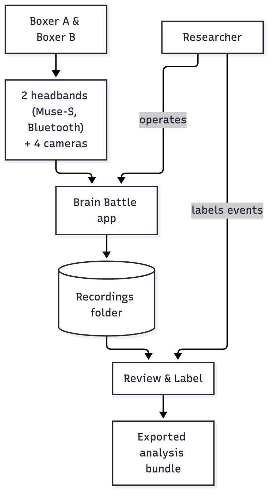

# Overview

**What this page covers:** what Brain Battle is, who uses it, and the three
screens you'll spend most of your time in.

## What it is

Brain Battle is a desktop app that records a boxing sparring session from
two angles per boxer (four cameras total) and each boxer's brain activity
(a Muse-S headband over Bluetooth) at the same time, on one shared clock, so
a researcher can later watch the video and the brain signal together and
mark what happened — a jab, a block, a clinch — against the moment it
happened on both.

It is built for one specific research use: synchrony between two boxers'
brain activity during sparring. Everything in the app exists to get a clean,
time-aligned recording with as little friction as possible for whoever is
running the session, and to make labelling what happened afterwards fast.

## Who uses it

- **The person running a session** — plugs in the cameras, puts the
  headbands on both boxers, and presses record. No programming knowledge
  needed; see the [User guide](../user-guide/sessions.md).
- **The person labelling afterwards** — watches the recording back and marks
  events (who threw what, when); often the same person, sometimes someone
  else on the team.
- **The person analysing the data** — opens the exported files in Python,
  R, or similar; see [Research & data](../research-and-data/recording-folder.md).
- **Developers and successors** — students or researchers who pick up the
  codebase later; see the
  [Developer guide](../developer-guide/architecture.md).

## The three screens

Brain Battle has three screens plus Settings, reached from the sidebar on
the left:

| Screen | What you do there |
|---|---|
| **Sessions** | The home screen — every past recording, searchable and sortable. Open one to watch it back. This is where the app opens. |
| **New recording** | Three screens: get ready (check the cameras and headbands, type the boxer names, set the rounds), record, and a summary when you're done. |
| **Review & Label** | Watch a recording back with both boxers' brain activity alongside the video, and mark events. |

Settings (at the bottom of the sidebar) holds everything you'd want to
change before a recording — which folder recordings are saved to, which
headband belongs to which boxer, video quality, default round lengths, and
the list of labels your team uses.

## How the pieces fit together

The two boxers wear headbands and are filmed by four cameras; everything
feeds the Brain Battle app, which writes each session to your recordings
folder. From there you review and label it, and — when you're ready — export
an analysis bundle.

A recording is everything from one session: four camera videos, both
boxers' brain recordings, and the round/break timing, all saved together in
one dated folder inside your **recordings folder** (see
[Settings](../user-guide/settings.md) for where that is and how to change
it). Nothing leaves that folder until you choose to
[export](../user-guide/export.md) it.

## Where to go next

- New to the app? Continue to [Installation](installation.md).
- Already installed? Jump to [First run](first-run.md) or the
  [Quick tour](quick-tour.md).
- Looking for how to do something specific? Go straight to the
  [User guide](../user-guide/sessions.md).
