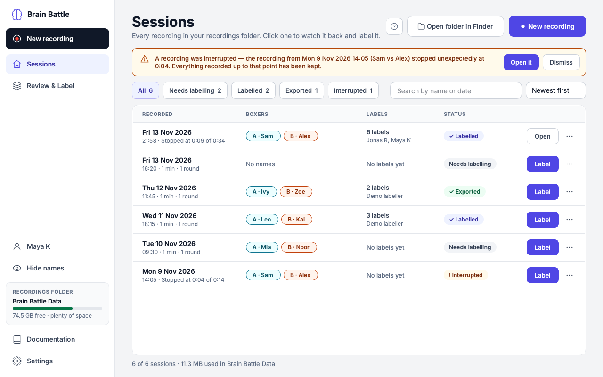
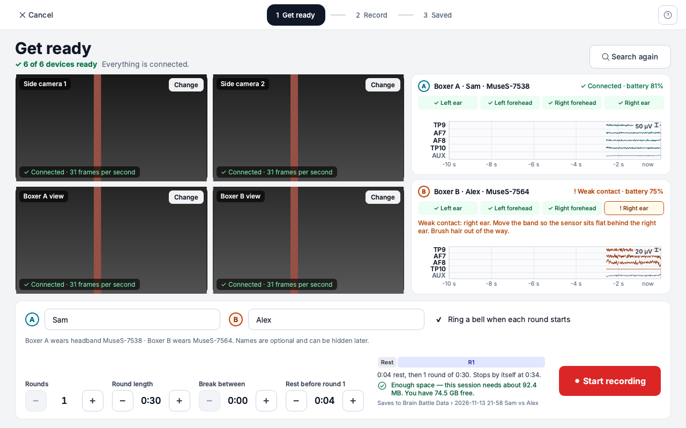
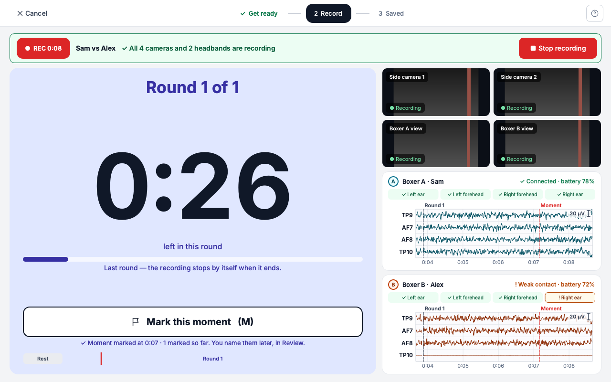
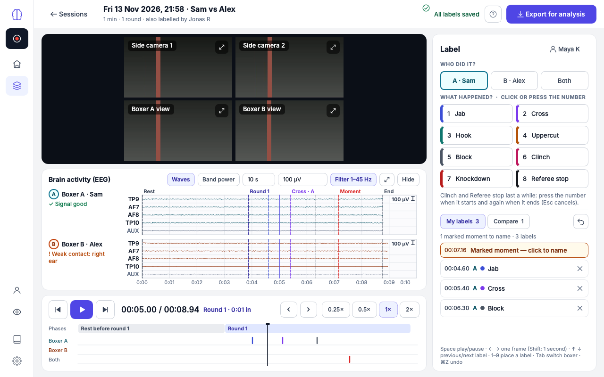
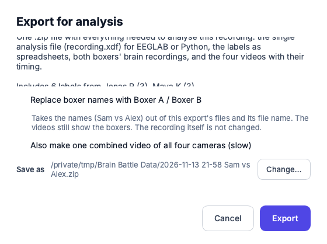
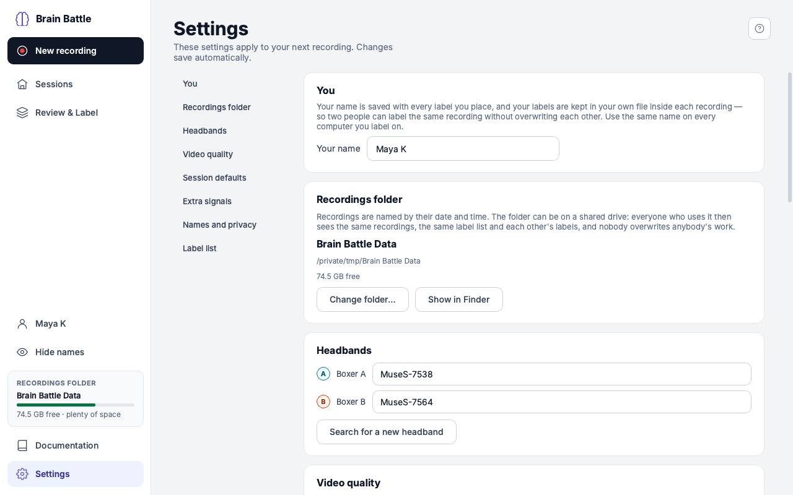

# Quick tour

**What this page covers:** one picture and a few lines per screen, so you know
what you're looking at before diving into the full
[User guide](../user-guide/sessions.md).

## Sessions

Every recording in your recordings folder. Click a row to open it; the button
says **Label** until you have labelled it. **New recording** — here and at the
top of the sidebar — starts one.

## New recording

Three screens: **Get ready** (check the devices, type the names, press Start),
**Recording** (a large countdown you can read from across the room), and
**Saved**. See [New recording](../user-guide/new-recording.md).

## Review & Label

Watch a recording back with both boxers' brain activity under the video, and
mark who did what, when, in the labelling panel on the right. Several people
can label the same recording; **Compare** shows another person's labels beside
yours and how far you agree. See
[Review & Label](../user-guide/review-and-label.md).

## Export for analysis

One zip file with everything for analysis — led by `recording.xdf`, which
opens directly in EEGLAB and Python. You can replace the boxers' names with
"Boxer A" and "Boxer B". See [Export](../user-guide/export.md).

## Settings

Your name, the recordings folder, headbands, video quality, session defaults,
privacy, and your team's label list. Everything saves by itself.
