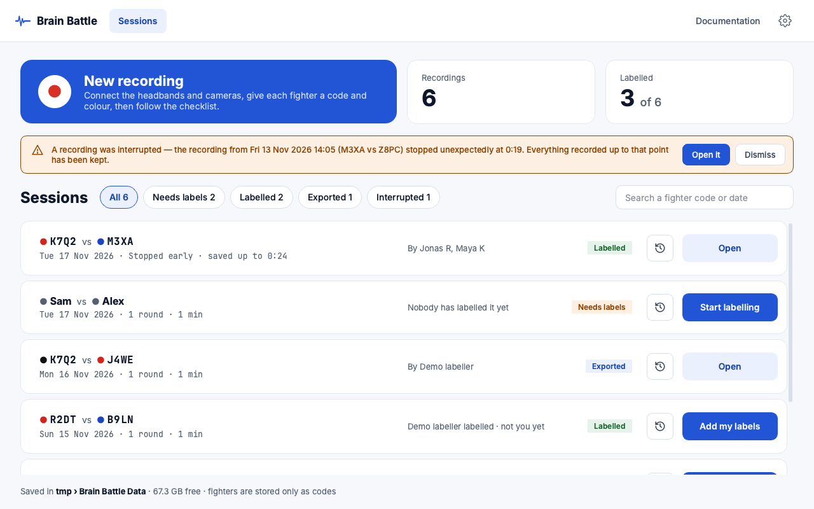
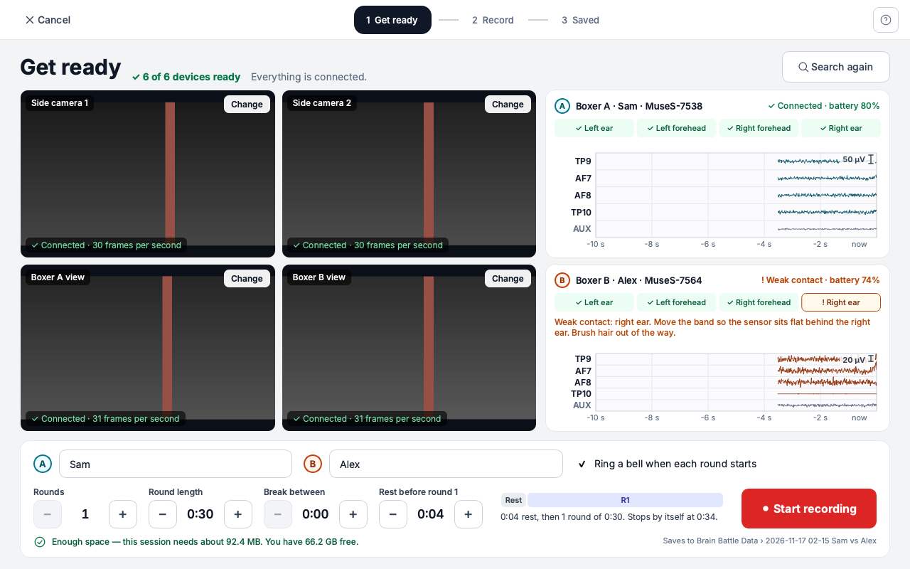
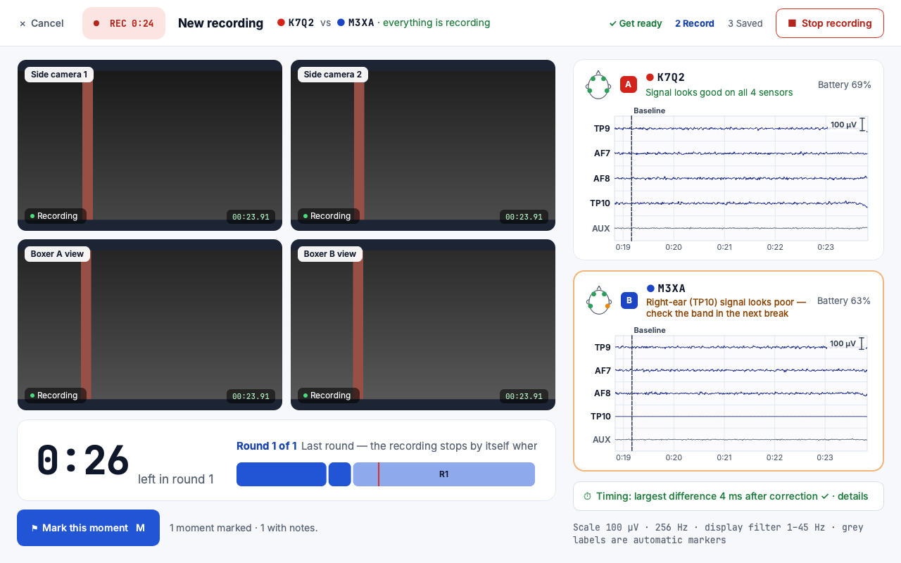
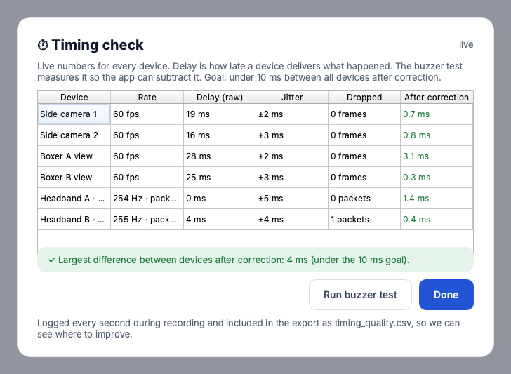
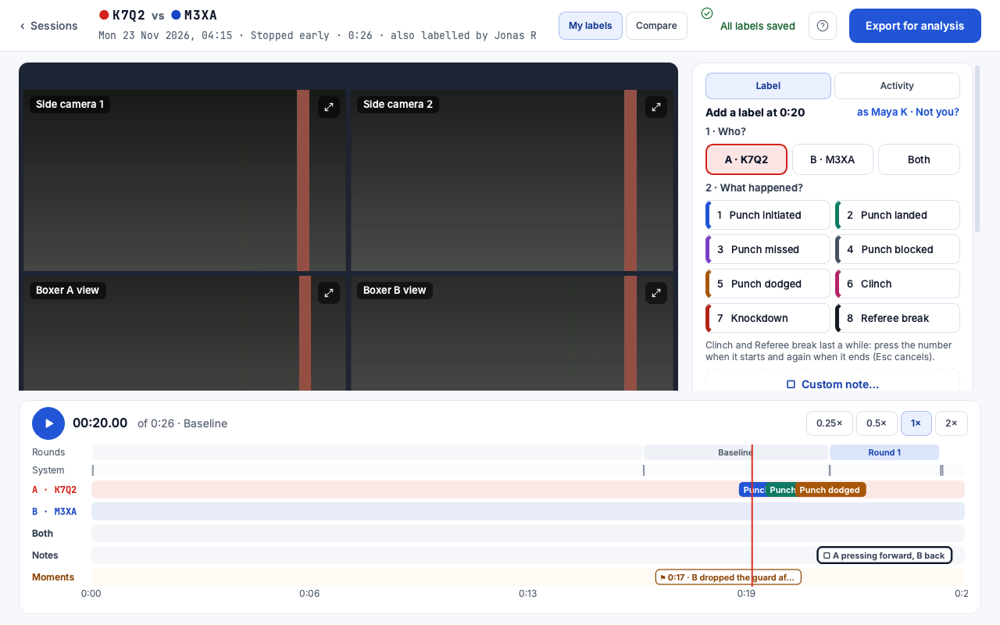
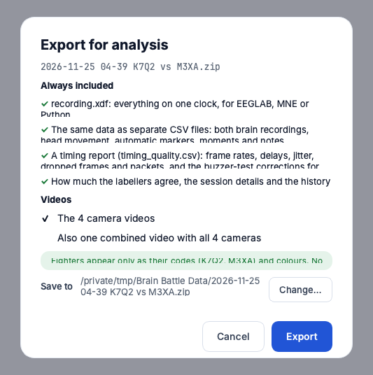
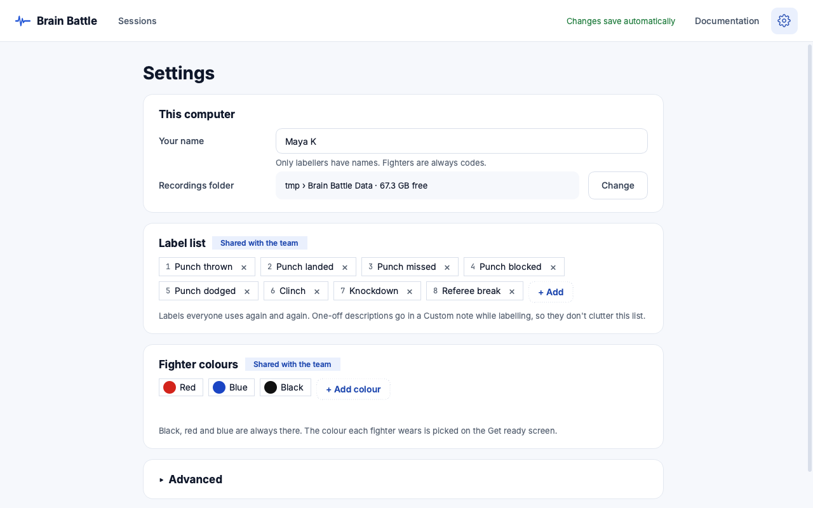

# Quick tour

**What this page covers:** one picture and a few lines per screen, so you know
what you're looking at before diving into the full
[User guide](../user-guide/sessions.md).

## Sessions

Every recording in your recordings folder, newest first, each with its two
fighter codes and colours, its status, and the button for your next step
(**Start labelling**, **Continue labelling**, **Add my labels** or **Open**).
The big blue **New recording** button starts one.

## New recording

Three screens: **Get ready** (work down the checklist, give each fighter a code
and colour, test the timing, press Start), **Recording** (starts 15 s before
the baseline; the countdown sits under the cameras; **M** marks a moment), and
**Saved**. See [New recording](../user-guide/new-recording.md).

## Review & Label

Watch a recording back with both boxers' brain activity, and mark who did what,
when, in the Label panel on the right; add custom notes and write the notes for
marked moments. Several people can label the same recording; **Compare** shows
how far you agree. See [Review & Label](../user-guide/review-and-label.md).

## Export for analysis

One zip file with everything for analysis — led by `recording.xdf`, which
opens directly in EEGLAB and Python — plus the same data as CSV files and the
timing report. Fighters appear only as codes, so there is nothing to hide. See
[Export](../user-guide/export.md).

## Settings

Your name and the recordings folder; the team's label list and fighter colours;
and, under Advanced, head movement, pulse, 60 fps cameras, live signals (LSL),
headbands and video quality. Everything saves by itself.
