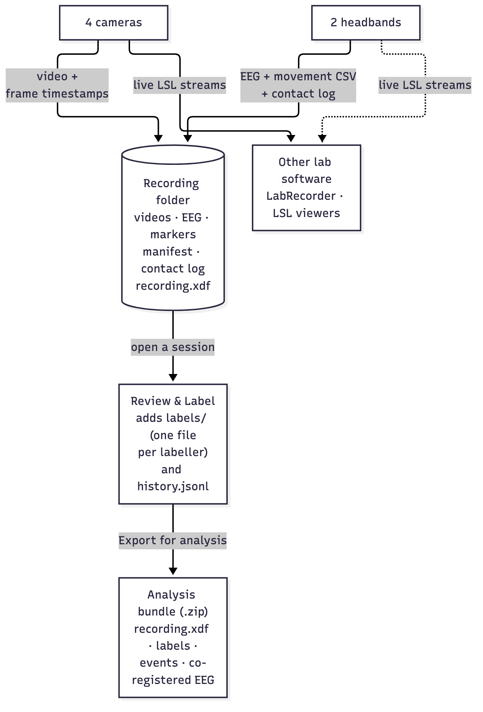

# Recording folder anatomy

**What this page covers:** what a single recording looks like on disk — every
file and folder, what each one is, who writes it, and whether it's written
while you record or added later. If you're about to load a recording for
analysis, start here, then see the [File format reference](file-formats.md)
for the exact columns.

## The short version

One recording is **one folder**. Everything about that session — all four
camera videos, both boxers' brain recordings, the round markers, the labels
you add later, and a log of what happened — lives inside it. Nothing is stored
in a database; copy the folder and you've copied the whole recording.

Recordings sit inside your **recordings folder** — by default
`~/Documents/Brain Battle Data`, changeable in Settings; see the
[Settings guide](../user-guide/settings.md). One extra file,
`label_list.json`, lives in the recordings folder itself and is **shared by
every recording** in it — it's the team's label vocabulary, not part of any
one session.

## The folder tree

A recording folder is named for when it started and who was in it, e.g.
`2026-11-09 17-26 Sam vs Alex/`. Inside:

```
2026-11-09 17-26 Sam vs Alex/
├── session_manifest.json       the session's "what / when / who"
├── phase_markers.csv           where each baseline/round/break begins
├── contact_quality.csv         per-sensor contact quality, ~1×/second
├── history.jsonl               append-only log of what happened
├── labels/                     the labels placed in Review & Label —
│   ├── maya-k.json                 one file per labeller
│   └── jonas-r.json
├── recording.xdf               everything on one clock, for EEGLAB / Python
└── continuous/
    ├── Side Cams/
    │   ├── session_SIDE_01.mp4    (+ .timestamps.csv sidecar)
    │   └── session_SIDE_02.mp4    (+ .timestamps.csv sidecar)
    ├── POV Cams/
    │   ├── session_POV_01.mp4     (+ .timestamps.csv sidecar)
    │   └── session_POV_02.mp4     (+ .timestamps.csv sidecar)
    ├── Muse data/
    │   ├── session_Muse S <id A>.csv    Boxer A's EEG
    │   └── session_Muse S <id B>.csv    Boxer B's EEG
    └── Muse sensors/                    (only if switched on in Settings)
        ├── session_Muse S <id A>_ACC.csv    head movement: accelerometer
        ├── session_Muse S <id A>_GYRO.csv   head movement: gyroscope
        └── …                                the same for Boxer B; _PPG = pulse
```

Each camera video has a **sidecar** next to it — a `.timestamps.csv` file with
one row per recorded frame. That sidecar is how a frame is placed on the shared
session clock (see [Timing & accuracy](timing-and-accuracy.md)).

## Who writes what, and when

Some files are written **while you record**; others are added **later**, when
you open the session in Review & Label or export it. This matters for
analysis: a freshly captured session has no `labels/` folder until someone labels
it.

| File / folder | What it is | Written by | When |
|---|---|---|---|
| `session_manifest.json` | The session's facts: app version, start time, boxers, the shared clock origin, the round plan, and each phase's start/end | `session_storage.SessionLayout` | During recording (updated as phases open/close) |
| `continuous/*/*.mp4` | One H.264 video per camera, no audio | `usb_camera.FrameEncoder` | During recording |
| `continuous/*/*.timestamps.csv` | One row per recorded frame, placing it on the session clock | `usb_camera.FrameEncoder` | During recording |
| `continuous/Muse data/*.csv` | One brain recording per boxer (the raw EEG) | `eeg_module` (`_MuseDirectReader`) | During recording |
| `continuous/Muse sensors/*.csv` | Each headband's movement (and optionally pulse) sensors | `eeg_module` (`_MuseDirectReader`) | During recording, if switched on |
| `recording.xdf` | Every signal above plus markers, labels and each video frame's time, on one clock, in the standard Lab Streaming Layer format | `session_xdf.build_session_xdf` | Right after recording; rebuilt on every export, and for an interrupted recording when the app next finds it |
| `phase_markers.csv` | The instant each baseline / round / break starts | `session_storage.SessionLayout.append_marker` | During recording |
| `contact_quality.csv` | Each sensor's contact quality, ~once per second | `contact_log.ContactLogWriter` | During recording |
| `history.jsonl` | Append-only log: recording started/finished, opened for review, labels added/removed, exported | `session_history.log_event` | During recording **and** later |
| `labels/<labeller>.json` | One labeller's labels on the timeline (one file per person) | `labels_store.LabelsStore` | Later, in Review & Label |
| `../label_list.json` | The shared team label vocabulary (one per recordings folder) | `label_vocab` | First time a recording folder is used |

## How the data flows

From the cameras and headbands, into one folder, into Review & Label (which
adds the labels and history), and out as an analysis bundle:



The **analysis bundle** (the export zip) is a self-contained copy of the parts
an analyst needs, plus a couple of derived files (labels and events as CSVs,
and both boxers' EEG merged onto one clock). It's described in full under
[the export zip](file-formats.md#the-export-zip). The only thing an export
changes in the recording folder is `recording.xdf`, which it rebuilds so that it
includes your labels.

`recording.xdf` is always *derived* from the other files — it can be deleted
and rebuilt at any time
(`python3 -m brain_battle.data.session_xdf "<recording folder>"`), so the CSVs
and videos remain the originals.

## A note on "continuous"

The `continuous/` subfolder is a historical name from when a recording could in
principle be split per round; today a session is one continuous take per
camera, so everything lives under `continuous/`. The `folder` field inside each
phase in the manifest reflects this (it's `"continuous"` for every phase).
