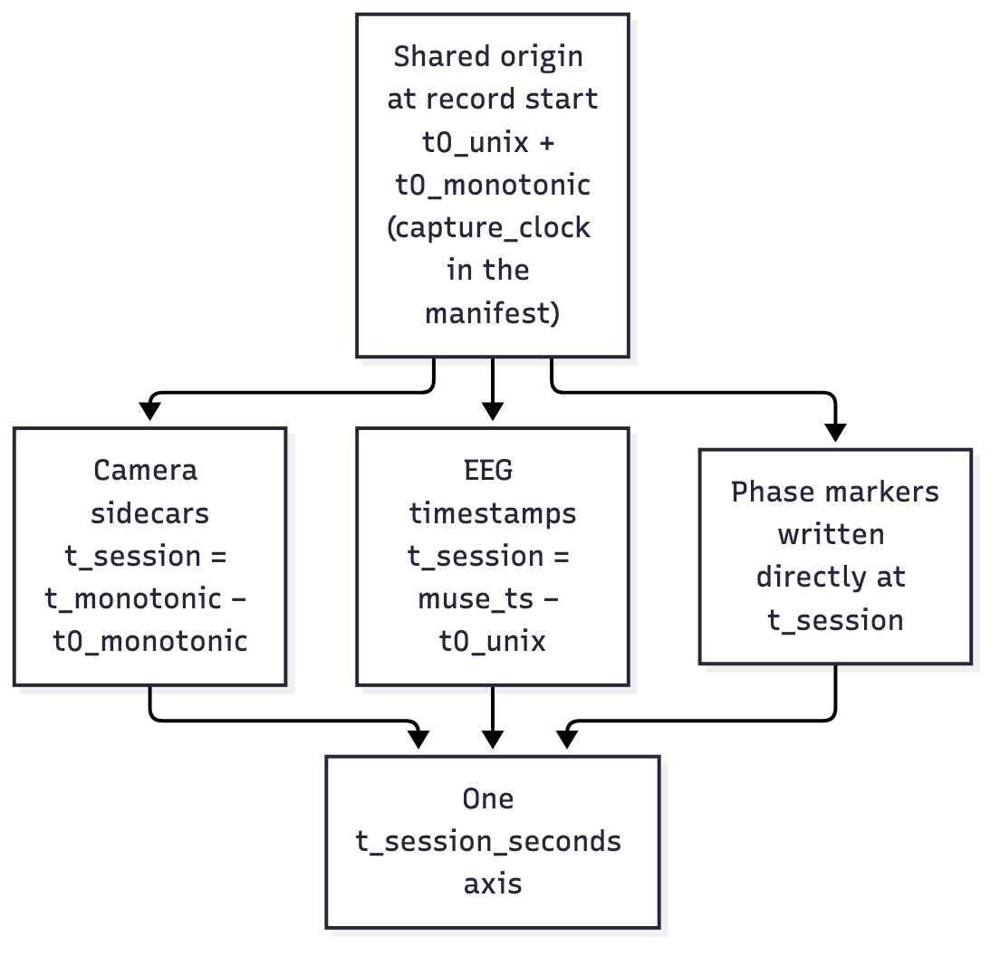

# Timing & accuracy

**What this page covers:** how all four cameras, both brain recordings, and the
round markers end up on one shared clock; what about that clock is *measured*
versus *assumed*; the accuracy numbers we actually have; and what that means
for different kinds of analysis. If your analysis depends on precise timing
between the two boxers, read this before you trust it.

## One session, one clock

Everything in a recording is placed on a single timeline:
**`t_session_seconds`** — seconds since the session started. A video frame, an
EEG sample, and a round marker with the same `t_session_seconds` are meant to
be the same instant.

That works because the app stamps everything from **one clock** — the
computer's monotonic clock, which never jumps when the wall clock is corrected —
and, at the moment recording starts, captures **one shared origin** on it
(`clock.session_origin`). The origin is stored as `capture_clock` in the
manifest in three forms: the monotonic reading itself, the same instant as Unix
time, and the same instant on the Lab Streaming Layer (LSL) clock. Those three
are the same clock seen through constant offsets
([ADR-0017](../decisions/adr-0017-one-capture-clock.md)). Each source is then
placed relative to that origin:

- **Camera frames:** each frame's monotonic capture time minus
  `t0_monotonic` (`usb_camera.FrameEncoder._write_sidecar_row`).
- **EEG samples:** each sample's arrival time on the same clock (expressed as
  Unix time) minus `t0_unix` (`eeg_module`).
- **Inside `recording.xdf`:** every timestamp is `t0_lsl + t_session_seconds`,
  so subtracting the session start gives `t_session_seconds` back exactly.
- **Phase markers:** written directly in `t_session_seconds`
  (`session_storage.append_marker`).

There is nothing to "sync" by hand — alignment is this arithmetic, applied as
the files are read.

## Measured vs. assumed

| Part of the clock | Status |
|---|---|
| The shared origin (`capture_clock`) | **Measured** — one reading, taken once at start |
| Camera frame times (sidecars) | **Measured** — the real capture time of each frame is recorded per row |
| Camera-to-camera alignment | **Measured** in the demo (see the number below) |
| The arithmetic that places EEG on the axis | **Verified** by unit tests (`tests/test_capture_clock.py`) |
| The computer-side EEG clock (one monotonic clock for EEG, video and markers) | **Verified** by unit tests (`tests/test_xdf.py`) — a wall-clock correction mid-recording cannot shift EEG against video |
| The agreement between `recording.xdf`, the live LSL streams and the CSV files | **Verified** by reading them back (`tests/test_xdf.py`, `tests/test_lsl_streams.py`, `tests/test_record_flow.py`) |
| How muselsl spreads a packet's arrival time over its 12 samples | **Assumed / Not yet verified on hardware** |
| Bluetooth transport latency on the EEG | **Assumed negligible / Not yet verified on hardware** |

The distinction that matters: the *maths* of putting EEG on the shared axis is
tested and correct. What is **not** confirmed — because it needs a real Muse
band — is whether the EEG timestamps themselves are accurate to within
tens of milliseconds once Bluetooth latency is in the path. `eeg_module` logs
exactly this warning at the start of every EEG recording.

## The numbers we have

| What | Number | Source |
|---|---|---|
| Camera-to-camera frame alignment | within **one frame period (~34 ms)** at 30 fps | By design — each camera captures on its own phase |
| Flash spread across the four cameras (demo) | worst **17.2 ms** measured, bound **≤ 34 ms** | `tests/test_flash_sync.py` |
| EEG clock accuracy | **unknown — Not yet verified on hardware** | needs a real Muse band |
| Bluetooth EEG latency | **unknown — Not yet verified on hardware** | needs a real Muse band |

Two honest caveats behind the camera number: the per-phase white flash is
**not** perfectly simultaneous across cameras — each camera captures on its own
phase, so the first frame at or after an event can land up to one frame period
apart. That's expected and bounded; across every phase marker in the 12-minute
demo the worst measured spread was **17.2 ms**, comfortably inside the one-frame
bound. And one camera in the demo deliberately drifts (declares 30 fps, captures
~29.5 fps), so its frame period is ~33.9 ms — which is why the asserted bound is
34 ms, not 33.

## What this means for analysis

The timing you can rely on depends on the method. Stated neutrally — the
synchrony method for this project is not yet decided:

| Method | Timing it needs | Where the current clock stands |
|---|---|---|
| Power / envelope measures (band power, amplitude envelope correlation) | tolerant — tens of milliseconds | Within reach of the measured camera alignment; EEG side still hardware-unverified |
| Phase-based measures (PLV, coherence) | strict — a few milliseconds of between-brain alignment | **Not** established — depends on the unverified EEG clock and Bluetooth latency |

In short: envelope/power comparisons are the safer bet with today's clock;
phase-based between-brain measures should not be trusted until the EEG clock is
verified on hardware. Don't over-invest in tighter alignment until the method
is chosen and the hardware check below has been run — the precision may or may
not matter.

## The hardware verification procedure

This is the single check that discharges the EEG-clock and eyes-on-glass
unknowns at once. Run it the first time real hardware is available:

1. Fit both headbands and start all four cameras through a normal recording.
2. Create **one simultaneous physical event** both boxers and at least one
   camera can see — e.g. both boxers tap their gloves together on a buzzer, in
   view of a camera, at a known instant.
3. Record a short session that includes that event, then stop and save.
4. Open the session in Review & Label and find the event in the video.
5. Check that the EEG artifact (the movement/tap spike) lands at the **same**
   `t_session_seconds` as the camera frame showing the event, for **both**
   boxers.

If the EEG spike and the video frame line up at the same session time, the EEG
clock is good enough and the between-brain alignment in `recording.xdf` and
[`eeg_coregistered.csv`](file-formats.md#eeg_coregisteredcsv) is trustworthy.
The headband's movement sensors, when recorded, make the tap easy to find: it is
a sharp spike in the accelerometer stream. If
they're offset by a consistent amount, that offset is the Bluetooth/clock
latency to correct for. Until then, everything marked **Not yet verified on
hardware** on this page stays that way — see the full list under
[Known limitations](limitations.md).
