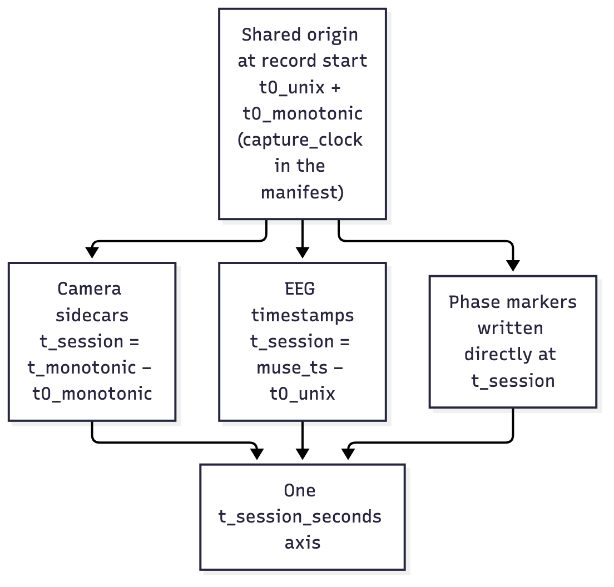

# Timing & accuracy

**What this page covers:** how all four cameras, both brain recordings, and the
round markers end up on one shared clock; what about that clock is *measured*
versus *assumed*; the accuracy numbers we actually have; and what that means
for different kinds of analysis. If your analysis depends on precise timing
between the two boxers, read this before you trust it.

## One session, one clock

Everything in a recording is placed on a single timeline:
**`t_session_seconds`** — seconds since the session started. A video frame, an
EEG sample, and a round marker with the same `t_session_seconds` are meant to
be the same instant.

That works because the app stamps everything from **one clock** — the
computer's monotonic clock, which never jumps when the wall clock is corrected —
and, at the moment recording starts, captures **one shared origin** on it
(`clock.session_origin`). The origin is stored as `capture_clock` in the
manifest in three forms: the monotonic reading itself, the same instant as Unix
time, and the same instant on the Lab Streaming Layer (LSL) clock. Those three
are the same clock seen through constant offsets
([ADR-0017](../decisions/adr-0017-one-capture-clock.md)). Each source is then
placed relative to that origin:

- **Camera frames:** each frame's monotonic capture time minus
  `t0_monotonic` (`usb_camera.FrameEncoder._write_sidecar_row`).
- **EEG samples:** each sample's arrival time on the same clock (expressed as
  Unix time) minus `t0_unix` (`eeg_module`).
- **Inside `recording.xdf`:** every timestamp is `t0_lsl + t_session_seconds`,
  so subtracting the session start gives `t_session_seconds` back exactly.
- **Phase markers:** written directly in `t_session_seconds`
  (`session_storage.append_marker`).

There is nothing to "sync" by hand — alignment is this arithmetic, applied as
the files are read.

## Each device is a little late — and we measure by how much

Every device delivers what happened a little late: a camera by its exposure,
USB transfer and decoding; a headband by Bluetooth (12 samples per packet, a
packet every ~47 ms). The delay differs per device. **The goal is under 10 ms
between all devices after correction**
([ADR-0024](../decisions/adr-0024-timing-check-and-buzzer-calibration.md)):

1. **Cameras at 60 fps** (Settings › Advanced, on by default), MJPG and a
   1-frame driver buffer: a camera's own uncertainty is ±8 ms instead of
   ±17 ms. A camera that cannot do 60 records at 30 and the app says so.
2. **De-jittered headband times.** Each Bluetooth packet's arrival is logged.
   Every sample gets the time of a straight line through (sample number,
   arrival) over the last ~90 s, with late outlier packets dropped — so
   arrival jitter never reaches the files. Missing packets are counted.
3. **Live timing.** Rate, jitter and lost frames / packets per device, live in
   the **Test timing** dialog and once a second in
   [`timing_quality.csv`](file-formats.md#timing_qualitycsv).
4. **The buzzer test** (Get ready → Test timing → Run buzzer test). Five beeps
   ~1.5 s apart; at each, both boxers tap their headband once, in view of the
   cameras. The tap is found in each headband's EEG (a sharp artifact,
   confirmed by the accelerometer) and in each camera (frame-difference
   energy, to a fraction of a frame). For each tap, every device is compared
   with the median of all devices — which cancels the beep's sound delay and
   the boxers' reaction time — and each device's **correction** is the median
   over the five taps. Corrections are saved as
   [`timing_calibration`](file-formats.md#timing_calibration) and applied to
   `recording.xdf`, `eeg_coregistered.csv` and Review & Label. Raw files are
   never changed.

## Measured vs. assumed

| Part of the clock | Status |
|---|---|
| The shared origin (`capture_clock`) | **Measured** — one reading, taken once at start |
| Camera frame times (sidecars) | **Measured** — the arrival time of each frame is recorded per row |
| Each device's delay relative to the others | **Measured** by the buzzer test, when it is run — and corrected |
| Headband arrival jitter | **Removed** by the per-band line fit (`timing.PacketTimer`) |
| The arithmetic that places EEG on the axis | **Verified** by unit tests (`tests/test_capture_clock.py`) |
| The calibration recovering known delays | **Verified with simulated devices** — within 2 ms (measured ~0.3–1.2 ms; `tests/test_timing.py`) |
| The agreement between `recording.xdf`, the live LSL streams and the CSV files | **Verified** by reading them back (`tests/test_xdf.py`, `tests/test_lsl_streams.py`, `tests/test_xdf_csv_parity.py`) |
| Real tap artifacts, real camera exposure, real Bluetooth delay | **Not yet verified on hardware** |
| The common delay of all devices relative to the computer's own markers | **Not measured** — the corrections are relative between devices; markers may sit a few tens of ms off all devices together |

## The numbers we have

| What | Number | Source |
|---|---|---|
| Calibration recovers simulated delays (6 devices, jitter ±2 ms cameras / ±4 ms headbands) | within **2 ms** (measured 0.3–1.2 ms) | `tests/test_timing.py` |
| Same on synthetic data, 40 random runs | 95 % within **2 ms** | `tests/test_timing.py` |
| Camera-to-camera frame alignment without a buzzer test | within **one frame period** (~17 ms at 60 fps, ~34 ms at 30 fps) | By design — each camera captures on its own phase |
| Flash spread across the four cameras (30 fps demo) | worst **17.2 ms** measured, bound **≤ 34 ms** | `tests/test_flash_sync.py` |
| Real hardware | **unknown — Not yet verified on hardware** | needs real cameras and Muse bands |

The per-phase white flash in the demo is **not** perfectly simultaneous across
cameras — each camera captures on its own phase, so the first frame at or after
an event can land up to one frame period apart. That is why the buzzer test
estimates the tap *within* a frame, from how much of the change each frame
shows.

## What this means for analysis

| Method | Timing it needs | Where the clock stands |
|---|---|---|
| Power / envelope measures (band power, amplitude envelope correlation) | tolerant — tens of milliseconds | Within reach without a buzzer test |
| Phase-based measures (PLV, coherence) | strict — a few milliseconds between brains | Needs the buzzer test; reached in simulation, **not yet confirmed on hardware** |

Check `largest_difference_ms` in the manifest (or the Saved screen) for every
recording you analyse, and the `timing_quality.csv` rows for the stretch you
use (dropped frames, missing packets, a camera that stalled).

## The hardware verification procedure

Run this the first time real hardware is available:

1. Fit both headbands, open New recording, press **Test timing** and **Run
   buzzer test**. Both boxers tap their headband once at each of the 5 beeps,
   in view of the cameras.
2. Check the dialog: every device found its taps, and the largest difference
   after correction is under 10 ms.
3. Record a short session; in it, make one more simultaneous physical event
   (both boxers tap together at a buzzer).
4. Open it in Review & Label: the EEG artifact of that event should land at
   the same `t_session_seconds` as the camera frame showing it, for both
   boxers, within ~10 ms.

Until then, everything marked **Not yet verified on hardware** on this page
stays that way — see [Known limitations](limitations.md).
