# November 2026 redesign pass (3.1.0-dev, second pass)

**What this page covers:** what changed on `develop` between the snapshot tag
`pre-redesign-2026-11-13` and the tag `v3.1.0-dev.2` — the redesign (with
before/after pictures), several labellers per recording, hiding boxer names,
Mac and Windows, shared-folder safety — plus the commits, the test results,
what still needs real hardware or a real Windows machine, and the decisions
waiting for the owner. Written by Claude (Anthropic's Fable 5.2 model) working
on its own from the owner's brief; nothing here has been reviewed by a person
yet.

- **Branch:** `develop` only. `main` was not touched.
- **To go back:** `git switch -c restore-pre-redesign pre-redesign-2026-11-13`.
- **Version:** `3.1.0-dev` (unchanged); tag `v3.1.0-dev.2`.
- **To look at it:** `BRAIN_BATTLE_SIMULATE=1 python3 -m brain_battle`, with a
  demo library: `python3 tools/generate_demo_session.py --out <empty folder>
  --library`, then choose that folder in Settings.

## In one paragraph

Every screen was redesigned around the three things people do — start a
recording, label it, export it. Starting a recording is one screen shorter.
The Recording screen can be read from across a gym. More than one person can
label the same recording without overwriting each other, and compare their
labels in plain language. Boxer names are in `recording.xdf` and exports, and
can be hidden per export or on screen. The app no longer breaks on Windows at
the first date it shows, says "Explorer" there instead of "Finder", and its
tests are now set up to run automatically on macOS and Windows (the first run
is still pending). A recordings folder shared
between computers is safe to label and export from. None of it has been tried
on a real Windows computer, a real network drive, or real hardware.

## 1. The redesign

The reasoning is in [ADR-0018](../decisions/adr-0018-november-2026-redesign.md);
`docs/DESIGN.md` was rewritten to match. Pictures are 1280×800, from simulated
devices; "before" is rendered from `pre-redesign-2026-11-13`.

### The frame (visible in every picture below)

- **New recording is the one filled button in the sidebar.** It was the second
  of three equal-looking menu items.
- The sidebar now shows **who is labelling** and a one-click **Hide names**.
- Body text is one size larger; every status is an icon shape plus words; all
  screens are built from one shared set of components (`ui/widgets.py`) instead
  of each styling its own.

### Sessions

| Before | After |
|---|---|
| 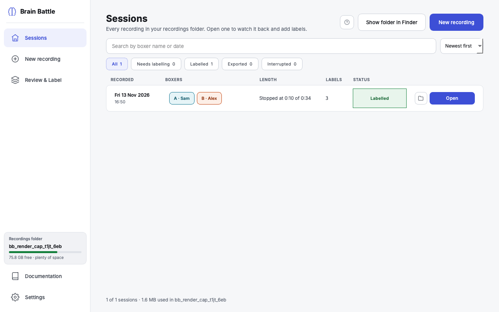 | 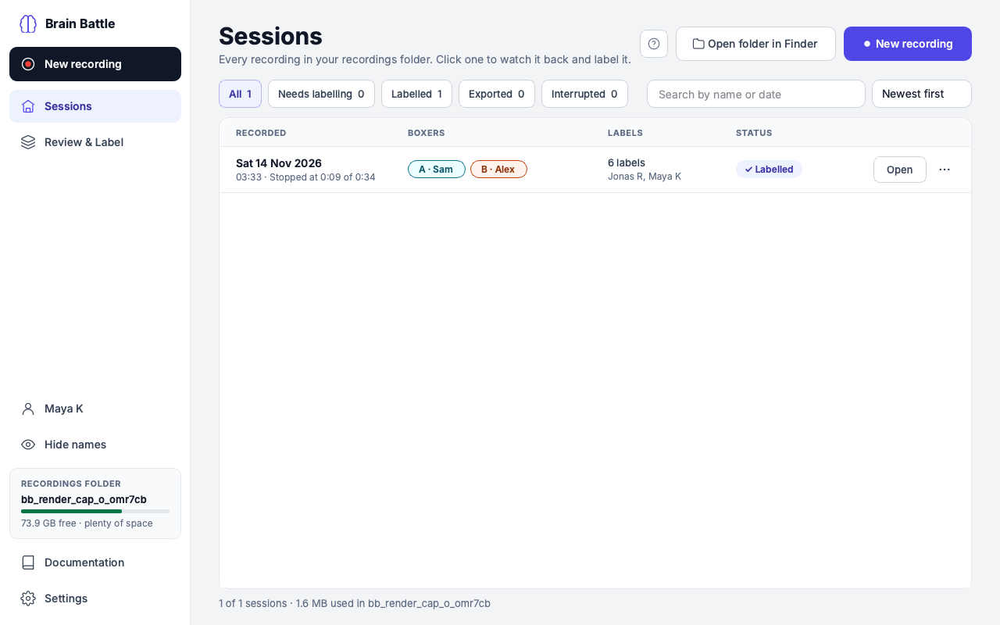 |

- Two rows of controls became one. The stack of bordered boxes became one clean
  list.
- **The whole row opens the recording.** Before, only the small button did.
- New *Labels* column: how many, **and who placed them**.
- The button says **Label** until *you* have labelled the recording, then
  **Open** — so a labeller sees their own to-do list.
- **Export without opening**: the ⋯ menu on each row.
- If the recordings folder is on a drive that is not connected, the screen says
  so with **Try again**, instead of looking empty.

### New recording: four steps became three screens

| Before (two steps) | After (one screen) |
|---|---|
| 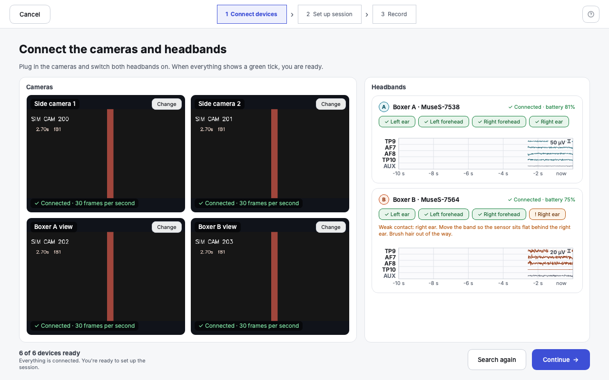 | 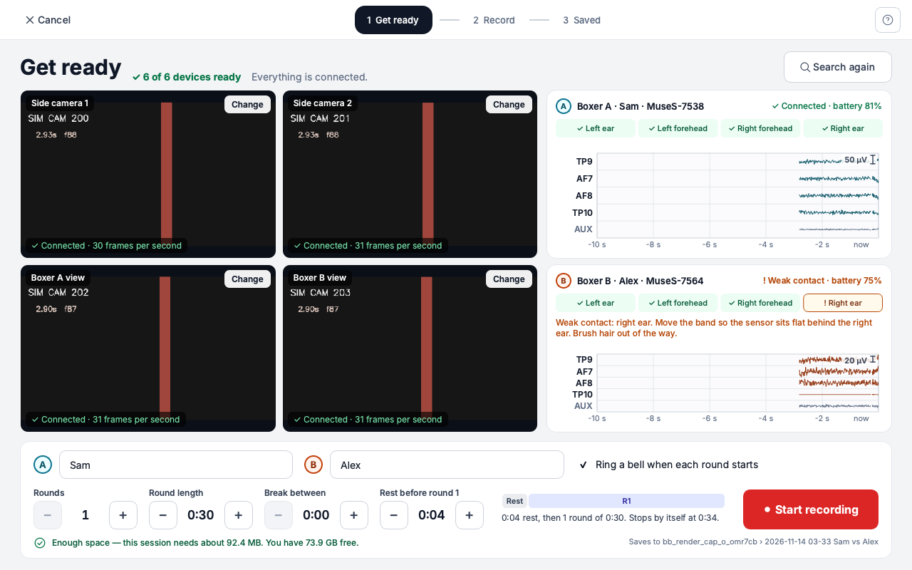 |
| 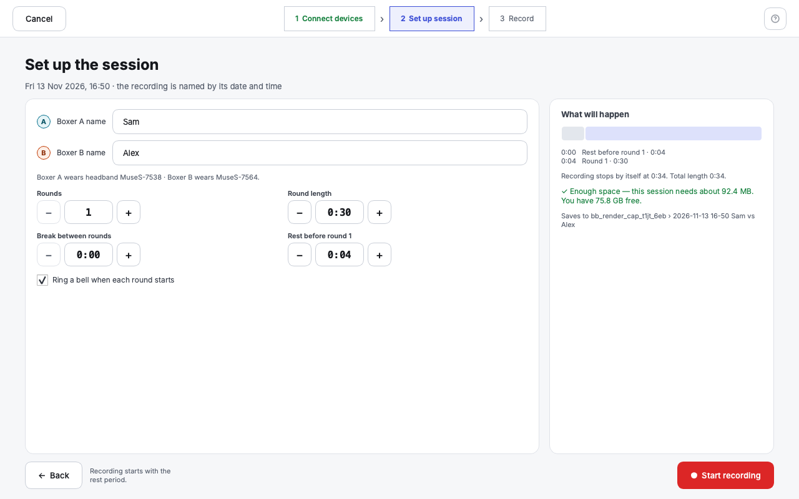 | |

- "Connect devices" and "Set up session" are now one **Get ready** screen: what
  you *check* on top, what you *do* underneath. Devices connect by themselves
  while you type the names — one click and one screen fewer per recording.
- The reason Start is unavailable (no space, folder not reachable) is right
  beside the Start button.
- The four sensor indicators became a strip that keeps each sensor in a fixed
  place, so a weak one is found at a glance.
- **Cost:** at the smallest window (1180×720) this screen is dense and the live
  brain activity on it is short. It is comfortable from 1280×800.

### Recording

| Before | After |
|---|---|
| 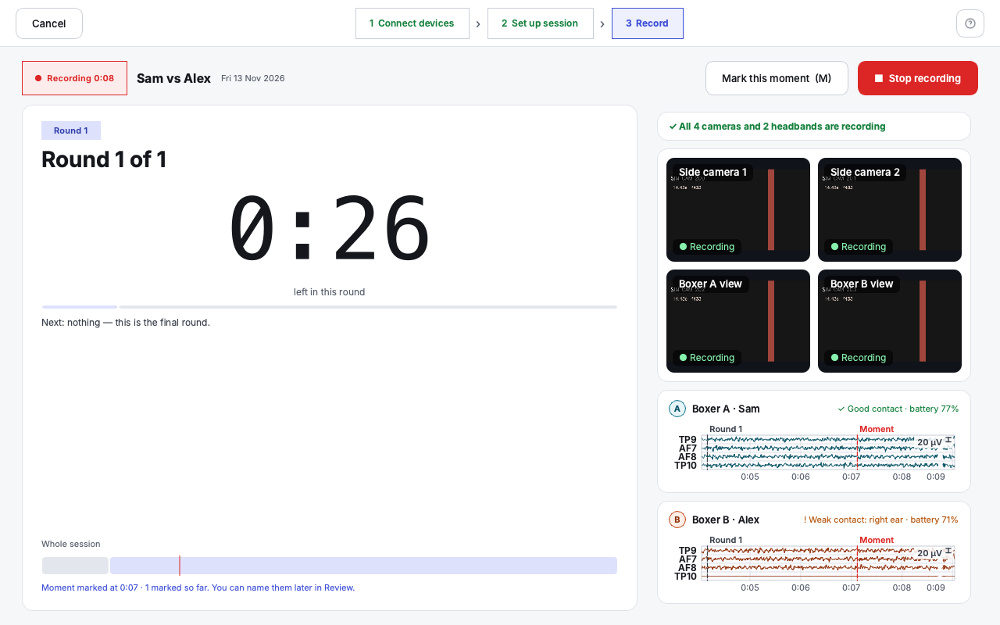 | 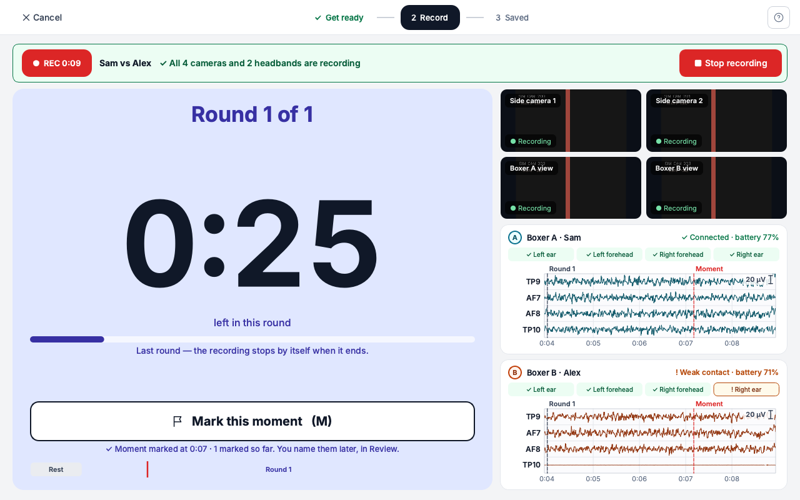 |

- One **status strip**: green, or amber with what is wrong. Before, the health
  line was a small card on the right.
- The card is **tinted by the phase** (grey rest, blue round, amber break) and
  the countdown is about 60% larger — readable from across a room.
- **Mark this moment** is a very large button in the middle. Before, it was an
  ordinary button in the top corner; it is the one thing pressed under
  pressure.
- **Your open decision 6:** the four contact indicators are **back** on this
  screen (as the compact strip), and the EEG display stays. Both fit.

### Saved

| Before | After |
|---|---|
| 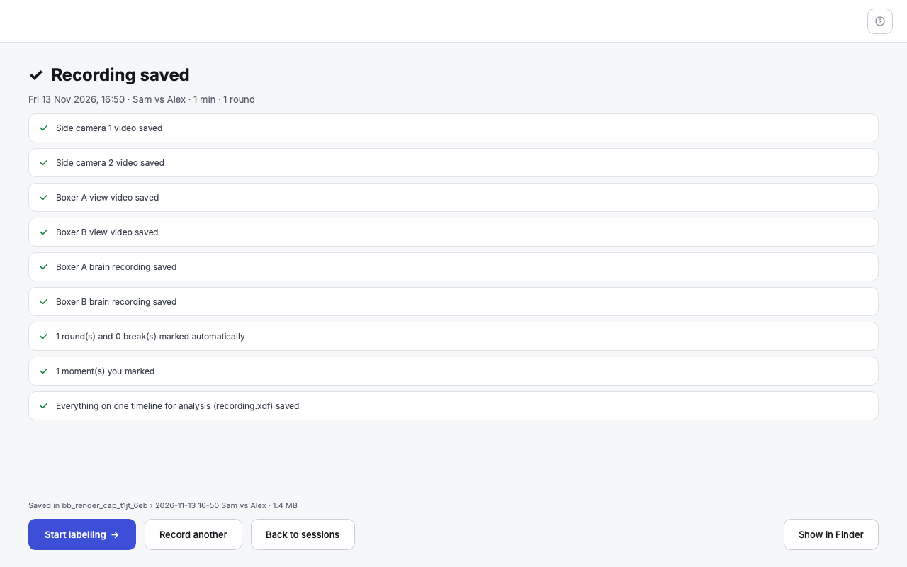 | 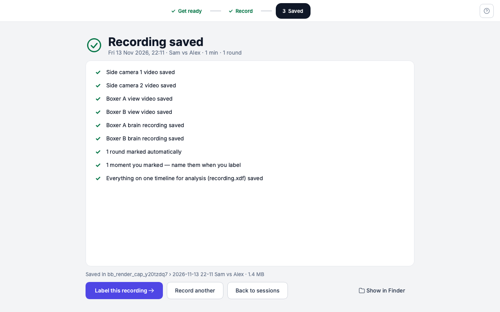 |

One calm card instead of a stack of boxes; "Start labelling" became **Label
this recording**; counts are written properly ("1 round", not "1 round(s)").

### Review & Label

| Before | After |
|---|---|
| 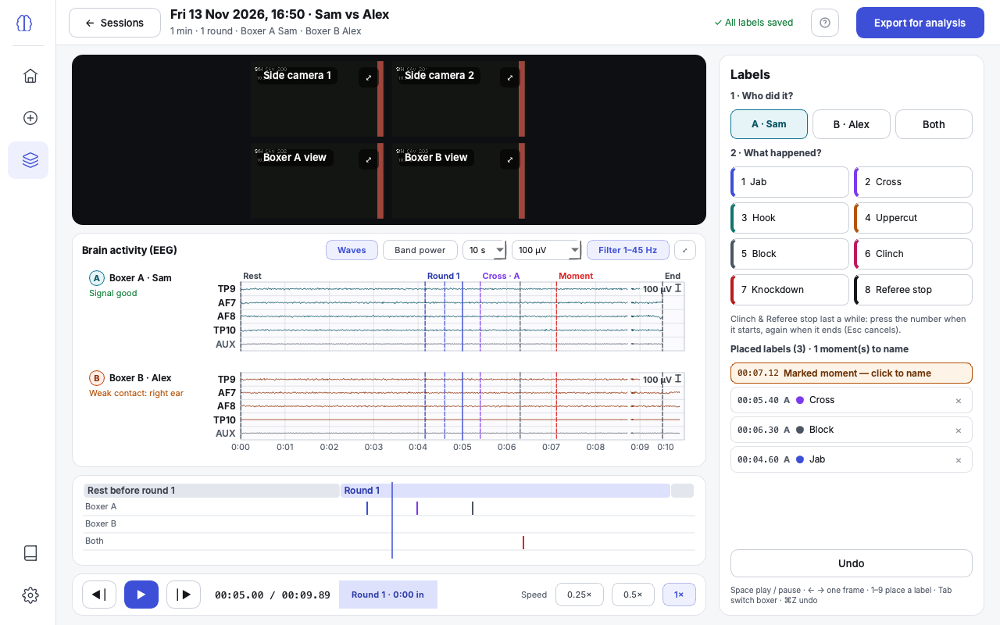 | 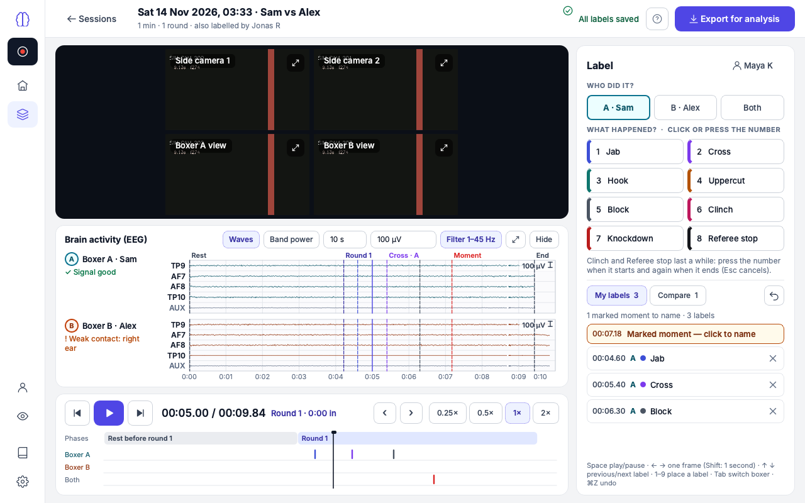 |

- **Transport and timeline are pinned** under the videos. Before, the timeline
  scrolled away with the page on smaller windows.
- The brain-activity card can be **folded away** (Hide), and gives up height on
  a small window — labellers mostly watch video.
- Lane names moved to a gutter; they used to sit on top of the labels.
- New: **2× speed**, **jump to previous / next label** (‹ › or ↑ ↓), **skip one
  second** (Shift+← →).
- The panel says **who is labelling**, and has two tabs: *My labels* and
  *Compare*.
- A label that "lasts a while" and is waiting for its end now shows an amber
  note in the panel; before, it borrowed the "saved" text in the top bar.

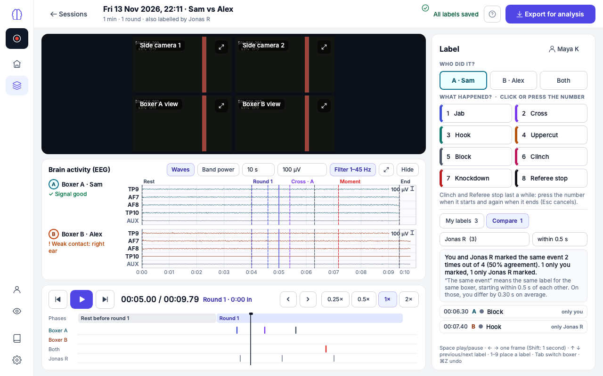

### Settings and Documentation

| Before | After |
|---|---|
| 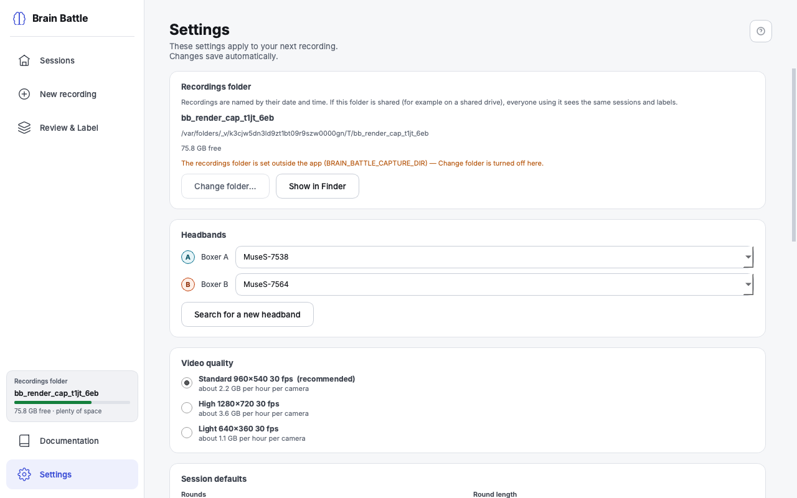 | 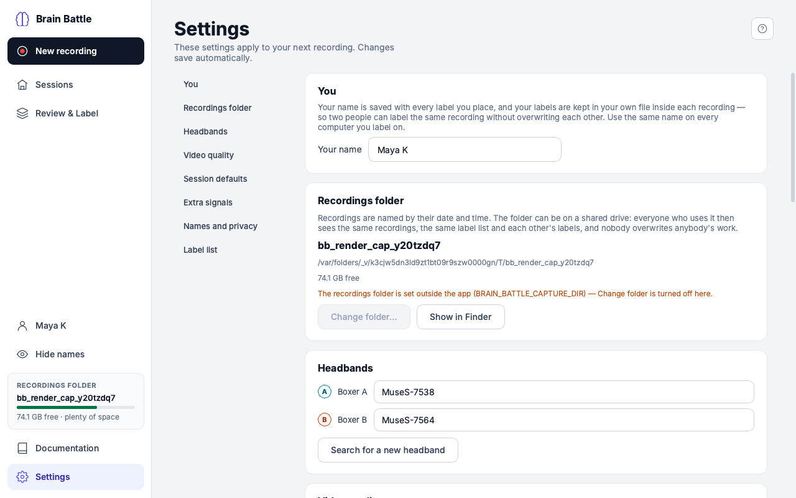 |
| 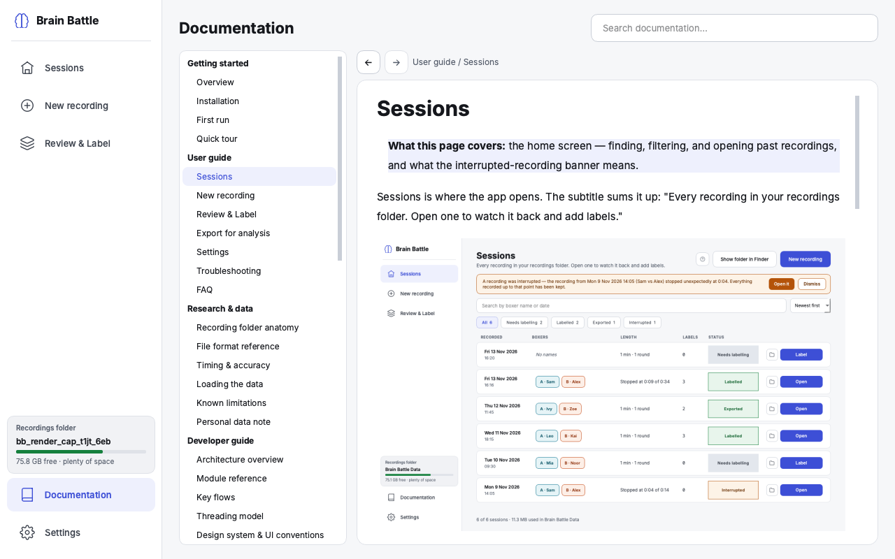 | 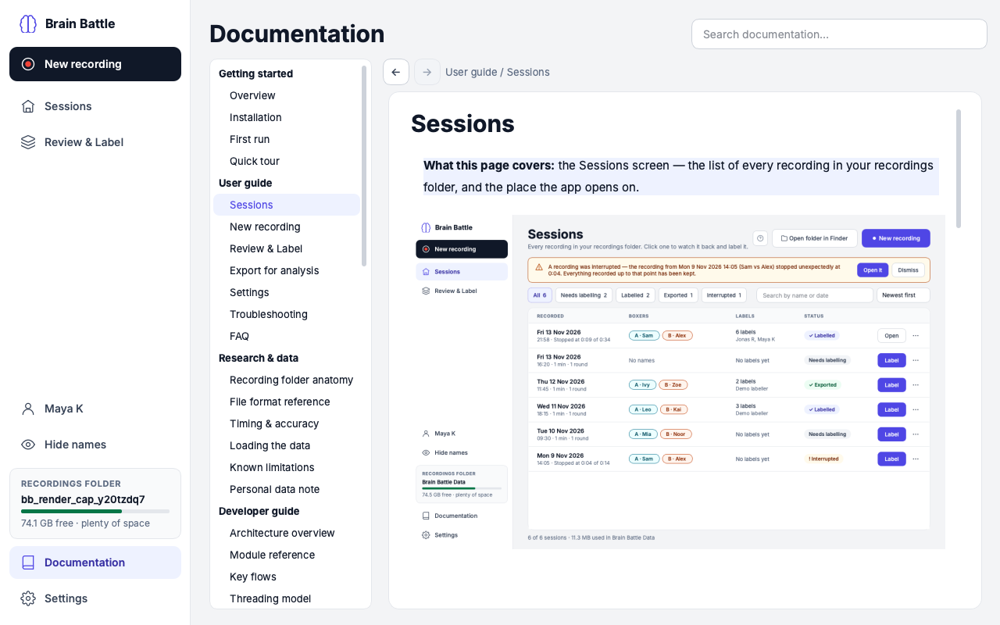 |

Settings has a section list on the left (the page had grown long) and two new
sections: **You** and **Boxer names and privacy**. The Documentation screen
keeps its structure and takes the new type and colours; the larger change
there is the content (section 6).

### Export

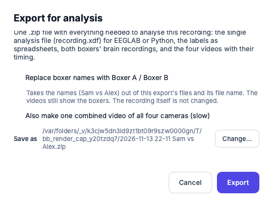

Says whose labels are included, offers the name-free option, and ends with
**Show in Finder / Explorer**.

## 2. More than one labeller per recording

[ADR-0019](../decisions/adr-0019-one-labels-file-per-labeller.md).

- **Each labeller's labels are in their own file** inside the recording:
  `labels/<labeller>.json`. Two people never write to the same file, on one
  computer or across a shared folder.
- **Who you are is a name**, asked once ("Who is labelling?" the first time
  you label, or Settings → You). No accounts. "Maya K" and "maya k" are the
  same person.
- In Review & Label you **label as yourself**. The **Compare** tab shows
  another labeller's labels in an extra grey lane — never in a label colour —
  and says how far you agree: *"You and Jonas R marked the same event 18 times
  out of 24 (75% agreement). 4 only you marked, 2 only Jonas R marked."* Below
  it, the list of differences; click one to jump there.
- **"The same event"** = same label, same boxer, start times within 0.5 s
  (changeable to 0.25 / 1 / 2 s); overlapping counts for labels that last a
  while. It is a count, deliberately not a chance-corrected statistic.
- Someone labelling on another computer right now shows up within about five
  seconds.
- **`recording.xdf`** has one label stream per labeller
  (`BrainBattle_Labels_<labeller>`); **`labels.csv`** and **`events.csv`** have
  a `labeller` column; an export with two or more labellers adds
  **`agreement.csv`**.
- **History** records who did what (`user`, plus the computer's name).
- **Existing recordings migrate by themselves.** An old `labels.json` is read
  everywhere as it is; the first time the recording is opened it moves to
  `labels/<name>.json` and the original is kept as `labels.json.v2.bak`. The
  screen offers **These are mine** to take those labels over.
- Marked moments stay in the recording, so each labeller names them.

Things to know: a misspelled name makes a second labeller (nothing is lost —
it shows in Compare); and anyone can type anyone's name.

## 3. Boxer names, and hiding them

[ADR-0021](../decisions/adr-0021-boxer-names-and-hiding.md). This reverses the
previous pass, which had left names out of the XDF.

- **Kept by default** in the manifest, in `recording.xdf` (`boxer_a_name`,
  `boxer_b_name`, `boxer_name`) and in exports.
- **Per export:** "Replace boxer names with Boxer A / Boxer B". That export's
  XDF, manifest copy, history copy, README and file name carry no names. A
  Settings switch decides whether the box starts ticked.
- **On screen:** *Hide names* in the sidebar (or ⇧⌘H / Ctrl+Shift+H) shows
  "Boxer A / Boxer B" in Sessions and Review & Label.
- **What it does not do** (and the docs say so): it does not hide faces in the
  videos, does not rename the recording's folder on disk, and does not remove
  labellers' names. A name-free export is not an anonymous one.
- A test builds a name-free export and searches every file in it for the names.

## 4. Mac and Windows

- **The date bug is fixed.** `%-d` appeared in five places; on Windows each
  would have raised an error the moment a date was shown (Sessions could not
  have listed a recording). All dates now go through one function, and a test
  fails if such a code appears anywhere in the source.
- **"Show in Finder" reads "Show in Explorer"** on Windows and opens Explorer;
  a test fails if a screen hard-codes "Finder".
- Shortcuts are written ⌘Z on a Mac and Ctrl+Z on Windows.
- **Audit of every platform-specific path** — what I found:

| Area | Finding |
|---|---|
| Keep-awake | Already had a Windows branch; confirmed it can never raise |
| File paths | Folder and file names were already Windows-safe; labeller file names are too. The screenshot tool had a hard-coded `/private/tmp` — fixed |
| ffmpeg encoder | Already tries NVIDIA → AMD → Intel on Windows with a real test encode and `libx264` fallback; now covered by a test. "ffmpeg not found" gives install help for the right system |
| Replacing files | Windows refuses to replace a file another program has open; all writes now retry briefly |
| Text files | Tests and CI run with UTF-8 forced, since Windows' default is not UTF-8 |
| Start-up failure | Waited for a key press in a console a windowed Windows launch does not have — removed |
| Bluetooth, fonts, sounds, LSL | One code path for both systems (bleak, bundled Inter, Qt sound, pylsl wheels). Nothing to change; nothing verifiable without a Windows machine |

- **GitHub Actions** (`.github/workflows/tests.yml`) runs the whole suite on
  macOS and Windows on every push. No accounts or secrets. **Its first run had
  not finished when this was written — see section 8.**
- Installation docs rewritten for both systems; new developer page
  [Cross-platform & CI](../developer-guide/cross-platform-and-ci.md).

## 5. A shared folder now, a server later

[ADR-0020](../decisions/adr-0020-shared-folder-safety.md).

- **Safe writes everywhere**: every file is written whole under a temporary
  name and swapped in, so another computer never sees half a file. The team's
  label list and later edits to a recording's manifest go through a small lock.
  History is only ever appended to.
- **Two computers on the same recording** cannot corrupt it: different
  labellers have different files; the same labeller on two computers is merged
  on save.
- **Slow networks:** the Sessions list re-reads only recordings that changed.
- **A drive that disconnects:** Sessions, the sidebar, Get ready and Review &
  Label each say so and what to do. Labels not yet saved are kept and saved
  when the drive is back.
- **Two real bugs found by the new tests and fixed:** saving labels, or writing
  history, into a recording whose folder had disappeared quietly created an
  *empty folder with the same name*; and the Sessions screen could crash if
  closed while still measuring folder sizes.
- **Recording straight onto a network drive** is allowed but warned about on
  Get ready — four video streams would depend on the connection.
- **Server notes** are in `docs/ROADMAP.md` Phase 7: what a server can rely on
  (a recording is one folder; its files are written-once, owned by one
  labeller, or append-only) and the questions its design must answer. Nothing
  server-side was built.

## 6. Documentation

Every user-guide page was rewritten for the new screens with new pictures;
Research & data leads with the app's own `recording.xdf` (LabRecorder is now
"optional, advanced"), and covers labellers and names; the Developer guide has
the new modules, updated diagrams and the cross-platform page; four ADRs
(0018–0021); status, roadmap, version history, changelog, `AGENTS.md` and the
README are current. The three documentation honesty tests pass.

## 7. Commits

| Commit | What |
|---|---|
| `ed042f4` | Data layer: one labels file per labeller, agreement, name hiding, shared-folder-safe writing, platform helpers, XDF and export changes |
| `7840394` | The redesign of every screen, the shared component set, app wiring |
| `3093c9e` | Four new test scripts, test isolation, existing tests updated, the GitHub Actions workflow, tool updates |
| `f573355` | Documentation: DESIGN.md, user guide and screenshots, Research & data, four ADRs, the cross-platform page, ROADMAP, changelog, AGENTS.md, README |
| `3d2510f` | Layout fixes found on a last look (Get ready at the smallest window; videos keep more height in Review & Label); screenshots refreshed |
| (this commit) | This review |

The commits are grouped by area rather than by feature, because the features
touch the same files. **The suite was run on the final state, not on each
commit** — the intermediate commits are not individually green (for example,
the code commit precedes the documentation its honesty tests require).

## 8. Test results

**On this machine (macOS, Python 3.13).** Before any change all 30 scripts
passed. After the four main commits, the full run was **34 of 34 scripts
passed** (`python3 tools/run_tests.py`, 417 s):

| Script | Result | | Script | Result |
|---|---|---|---|---|
| test_app_settings | PASS | | test_light_theme | PASS |
| test_capture_clock | PASS | | test_lsl_streams | PASS |
| test_contact_log | PASS | | test_no_placeholders | PASS |
| test_contact_quality | PASS | | test_platform *(new)* | PASS |
| test_crash_recovery | PASS | | test_player | PASS |
| test_demo_session | PASS | | test_privacy *(new)* | PASS |
| test_developer_docs | PASS | | test_record_flow | PASS |
| test_docs | PASS | | test_research_docs | PASS |
| test_eeg_streaming | PASS | | test_review_tab | PASS |
| test_eeg_viewer | PASS | | test_ring_buffer | PASS |
| test_export | PASS | | test_round_bell | PASS |
| test_flash_sync | PASS | | test_sessions | PASS |
| test_history_log | PASS | | test_settings_screen | PASS |
| test_label_vocab | PASS | | test_shared_folder *(new)* | PASS |
| test_labellers *(new)* | PASS | | test_smoke | PASS |
| test_labels_v2 | PASS | | test_video_recording | PASS |
| test_layout_fit | PASS | | test_xdf | PASS |

Honest notes:

- **The last commit (`3d2510f`, layout fixes) was followed by a partial run
  only**: the nine scripts it could affect — layout_fit, record_flow,
  shared_folder, settings_screen, docs, research_docs, developer_docs, smoke,
  no_placeholders — all passed. The other 25 were not re-run after it. Run
  `python3 tools/run_tests.py` once to confirm the final state.
- In an earlier full run `test_settings_screen` failed while other scripts
  were running and passed when re-run alone (it measures real time); the
  runner does that re-run automatically.
- The MNE example was not re-run by hand in this pass, and the EEGLAB example
  remains untried.

**On GitHub Actions (macOS and Windows): PENDING — not a pass.** The first run
(for `f573355`) had not finished when this was written: the **macOS job had
already failed** and its log was not yet readable, and the Windows job was
still running. So at this point there is **no evidence yet that the suite
passes on Windows**, and one unexplained failure on the macOS runner (the same
suite passes on this Mac, so a likely cause is the runner itself — no camera
or Bluetooth permissions, a slower machine for the timing tests, or a missing
piece of the environment — but that is a guess until the log is read).
Pushing this review starts a fresh run. Look at
<https://github.com/mohammadabdullahkhurram/Brain-Battle-Phase-3/actions>;
each failed job keeps its logs as a `test-logs-<system>` download. Expect the
first Windows run to need fixes: several older tests kill a helper program in
a way that only exists on macOS/Linux, and they have never run on Windows.

## 9. What needs real hardware, or a real Windows machine

**A real Windows computer** (none of this can be closed from here):

1. Cameras through Windows' camera system, four at once.
2. Two headbands over Windows Bluetooth.
3. The hardware video encoders on real NVIDIA / AMD / Intel graphics.
4. "Show in Explorer" with awkward folder names.
5. Staying awake through a long recording.
6. How the interface looks at 125% / 150% display scaling.
7. The firewall question when New recording opens.

**A real shared drive:** a Mac and a PC labelling the same recording on the
actual network share. The tests use several programs on one local disk, which
exercises the logic but not a real network file system.

**Real hardware** — unchanged from the previous review: EEG timing over
Bluetooth (the tap test), whether Muse EEG is usable during sparring, the
movement and pulse sensors, two headbands at once, battery level, live LSL with
real devices, and watching a real recording play.

**Also not done:** the EEGLAB example is still untried (no MATLAB here), and
nobody has yet used the redesigned screens with a real person in a real gym —
the design decisions above are reasoned, not observed.

## 10. Decisions for the owner

1. **Is the redesign right?** It is a large change to an approved design.
   Please run it and look at the pictures above. Anything can be moved back;
   the snapshot tag is the escape hatch.
2. **One "Get ready" screen instead of two steps** — the biggest structural
   change. If your smallest laptop makes it too cramped, the fix is to move the
   headbands' live brain activity behind a "Show" toggle on that screen, not to
   bring back the extra step. Say if you want that.
3. **Tolerance for "the same event": 0.5 s by default.** A guess. Whoever owns
   the labelling protocol should set it — and decide whether a formal agreement
   measure is needed.
4. **Two labellers, then what?** There is no step yet that turns two people's
   labels into the one set an analysis uses. Today an analyst picks a labeller.
   This is noted in ROADMAP Phase 7 ("Labelling finished").
5. **A labeller is a typed name.** Fine for a small team; tell me if you want
   something firmer before the server exists (for instance, a list of allowed
   names kept in the shared folder).
6. **Recording to a network drive: warn, or block?** I warn. If you would
   rather the app refused, it is a one-line change.
7. **"Hide names in exports" is off by default**, as you asked. If most exports
   leave the lab, you may want it on.
8. **The CI runs on every push to `develop` and `main`.** The repository is
   public, so it costs nothing. Say if you would rather it ran only on demand.
9. **Merge to `main`:** not done, as instructed. Before merging, someone should
   run one recording on a Windows computer.
