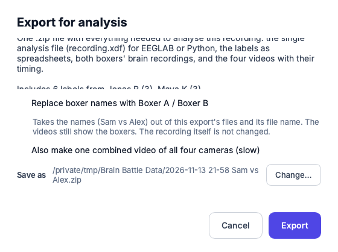

# Export for analysis

**What this page covers:** turning a recording into one file you can hand to
whoever analyses it.

Press **Export for analysis** in Review & Label, or **⋯ → Export for
analysis…** on a row in Sessions.

## What you get

One `.zip` file containing:

- **`recording.xdf`** — the main file: both boxers' brain activity, the head
  movement sensors, the round markers, **every labeller's labels** and the time
  of every video frame, all on one clock. It opens directly in EEGLAB,
  MNE-Python and pyxdf. Start here.
- **`labels.csv`** and **`events.csv`** — the labels as spreadsheets, with a
  `labeller` column saying who placed each one.
- **`agreement.csv`** — how far each pair of labellers agree (only when two or
  more people labelled the recording).
- Both boxers' brain activity on one timeline as a spreadsheet
  (`eeg_coregistered.csv`), the raw brain recordings, and the four videos with
  their timing files.
- The recording's details, round markers, history, and a README that explains
  every file.

The exact contents are listed in the
[File format reference](../research-and-data/file-formats.md).

## The two choices

- **Replace boxer names with Boxer A / Boxer B.** Tick this to make an export
  with no boxer names in it — not in its files and not in its file name. The
  videos still show the boxers themselves, and the recording on your disk is
  not changed. Whether the box starts ticked is set in
  [Settings](settings.md); details are in the
  [Personal data note](../research-and-data/personal-data.md).
- **Also make one combined video of all four cameras.** Off by default because
  it is slow. The combined video is for showing people; for analysis use the
  four separate videos, which keep every frame's exact time.

**Save as** shows where the file will go; **Change…** picks another place.
Press **Export**. When it has finished, **Show in Finder** (Mac) / **Show in
Explorer** (Windows) takes you to the file.

## Good to know

- You can export as often as you like. Each export contains the labels as they
  are at that moment, from everyone who has labelled so far.
- The recording's status in Sessions changes to **Exported**.
- A recording's history notes each export: who made it, whether names were
  replaced, and whose labels it contained.
