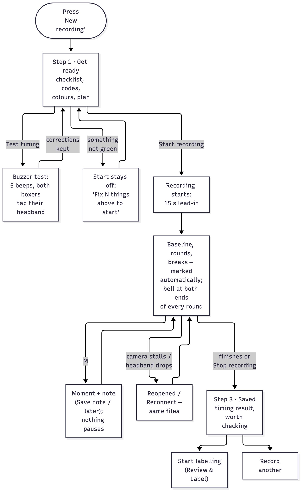
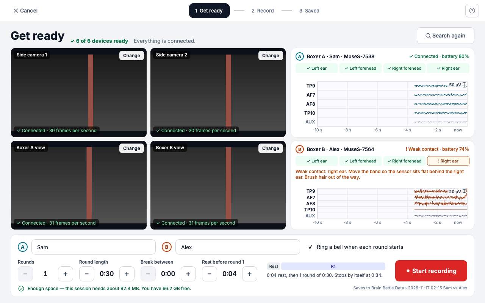
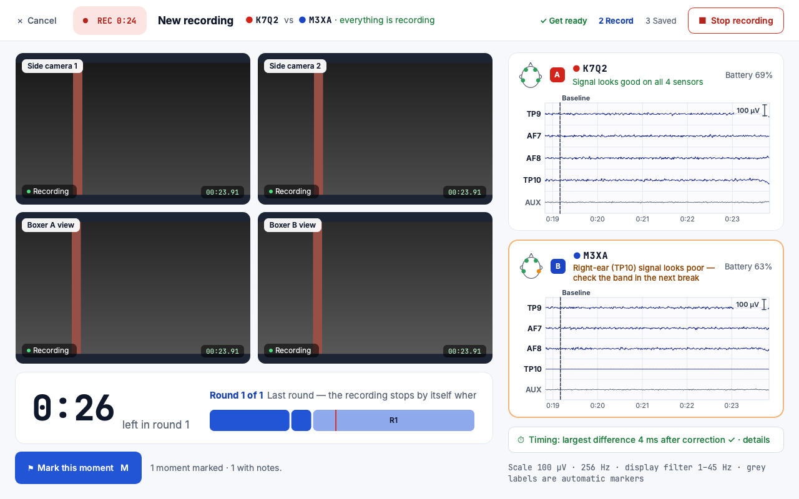
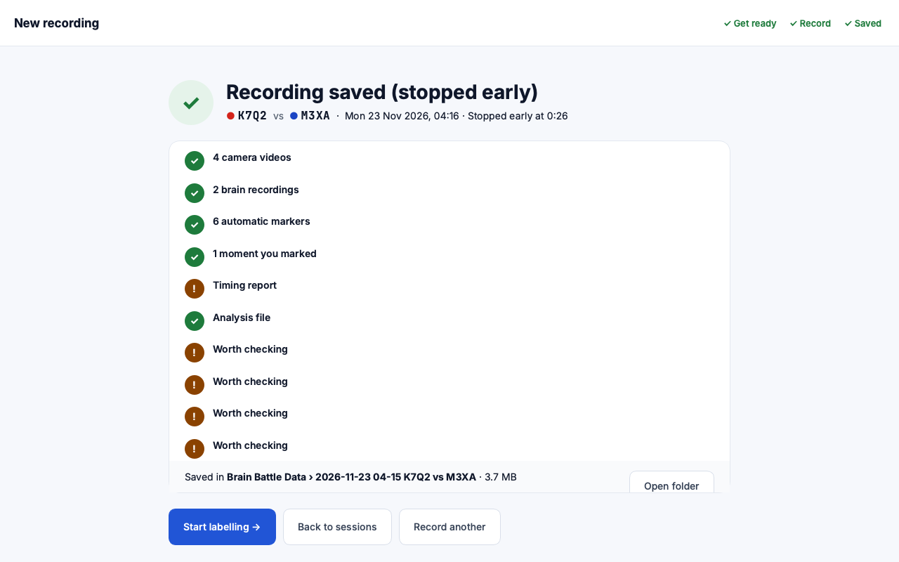

# New recording

**What this page covers:** making a recording, from pressing **New recording**
to "Recording saved". There are three screens: **Get ready**, **Recording** and
**Saved**. **✕ Cancel** (top left) leaves at any time.

## Step 1 — Get ready

The cameras and headbands connect by themselves while you fill in the rest.
**Work down the checklist on the left.** **Start recording** unlocks when every
required item is green; until then it says, for example, "Fix 2 things above to
start".

- **Headband A / B connected.** Switch each headband on. A headband that drops
  out says "Lost connection" with a **Reconnect** button.
- **Good signal on all sensors.** Each boxer's card shows a head seen from
  above with its four sensors: green when the signal looks good, orange when it
  looks poor. "The right-ear signal (TP10) looks poor" usually means the band is
  not flat behind the ear, or hair is in the way. Adjust it and press **I've
  adjusted it**. *This is the app's own judgement from the signal — the
  headband does not report how well it fits — so it advises but never blocks
  Start.* Under it is the live brain activity, five traces, five seconds across.
- **4 cameras connected.** Four live pictures, each with its frame rate (60 fps
  when Settings › Advanced › "Record cameras at 60 fps" is on). A camera that is
  not found shows a dashed outline: check its USB cable and press **Search
  again**. A camera that can only do 30 fps says so.
- **Fighter codes and colours.** Give each fighter a **code** — exactly 4
  capital letters or digits, like `K7Q2`; **New code** makes one up — and the
  **colour** they wear. The two codes and the two colours must differ. No names
  are stored anywhere; see [Personal data note](../research-and-data/personal-data.md).
- **Timing checked** (recommended). Press **⏱ Test timing**, then **Run
  buzzer test**. At each of the 5 beeps, both boxers tap their headband once,
  in view of the cameras. The app finds the taps in every camera and headband,
  measures how late each device is, and corrects for it. The dialog says
  whether the largest difference left is under the 10 ms goal. See
  [Timing & accuracy](../research-and-data/timing-and-accuracy.md).
- **Enough space.** How much the recording needs and how much is free.

**⇄ Swap the headbands between Boxer A and Boxer B** if the bands are on the
wrong boxers. **The plan:** Rounds, Round, Break and Baseline (− and +), and
**Ring the bell at the start and end of each round**. The line beside it says
the total — "0:15 lead-in + 12:00 = 12:15 in total" — and the plan is
remembered for next time.

Press **Start recording**. Recording starts **15 seconds before the
baseline** (the lead-in), so every device is running before anything that
matters happens.

## Step 2 — Recording

- **The header** shows **● REC** with the time recorded, the two fighters, and
  "everything is recording" — or "check the warning" when something needs
  attention (a yellow banner says what, for example "Side camera 2 stopped
  sending pictures — reconnecting").
- **The four cameras**, each with "Recording" and a timecode.
- **Under the cameras:** how long is left — "2:41 left in round 2" (during the
  lead-in: "until the baseline starts") — which part this is ("Round 2 of 3"),
  how many rounds are done, what comes next, and the plan bar with a red line at
  "now". The start and end of the recording, of the baseline and of every round
  and break are **marked automatically**; with the bell on, it rings at the
  start **and the end** of every round.
- **⚑ Mark this moment** (or press **M**) marks this instant. A small window
  asks "What did you see? (optional)" — type a note and press **Save note**
  (Enter), or **Add note later** (Esc) and write it in
  [Review & Label](review-and-label.md). Recording never pauses.
- **Right:** each boxer's head sensors, signal ("check the band in the next
  break" if it looks poor), battery, and live brain activity. Grey dashed lines
  with grey labels are the automatic markers; red ones are moments.
- **⏱ Timing** — the result of the buzzer test, or "not measured this
  session". Click it for the live timing numbers; recording carries on.

If a headband drops out, press **Reconnect**; its file continues when it is
back. If a camera stops sending pictures it is reopened by itself and its video
continues in the same file. The computer is kept awake for the whole recording.

**If a red message says something "could not be saved"**, part of the
recording's notes (for example the sensor-contact notes) could not be written
to the recordings folder. The cameras and headbands keep recording. Check the
drive; the Saved screen will say "saved, but with problems".

**Stopping early.** The recording stops by itself at the end of the last round.
To stop sooner press **■ Stop recording**; the app asks first. Everything
recorded so far is kept. Leaving with **✕ Cancel** while recording also keeps
everything, but marks the recording *Interrupted*.

## Step 3 — Saved

A list read from the real files: the camera videos ("No frames lost" or how
many), the brain recordings (and head movement), how many **automatic
markers**, the **moments you marked** and how many have notes, the **Timing
report** (or **Timing not measured**), anything **Worth checking** (weak
contact for a while, a camera that was reconnected, a camera that could only do
30 fps), and the analysis file `recording.xdf`. **Open folder** shows the
recording's folder, named like `2026-11-17 14-05 K7Q2 vs M3XA`.

If the heading reads **"Recording saved, but with problems"**, part of the
recording could not be written — the list says what. Keep the recording and tell
whoever looks after the app.

Then: **Start labelling →**, **Back to sessions**, or **Record another**.

## If something goes wrong

- The app closed or the computer crashed mid-recording: nothing recorded up to
  that moment is lost. Sessions shows "A recording was interrupted".
- "The recordings folder can't be reached": the drive is not connected. See
  [Troubleshooting](troubleshooting.md).
