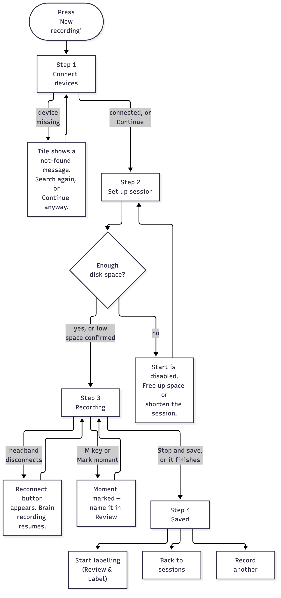
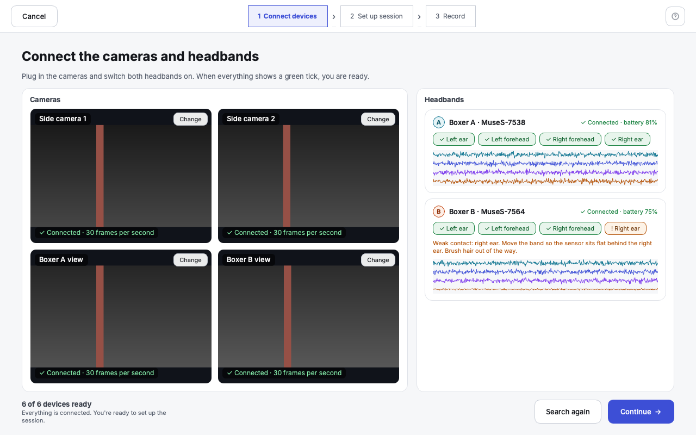
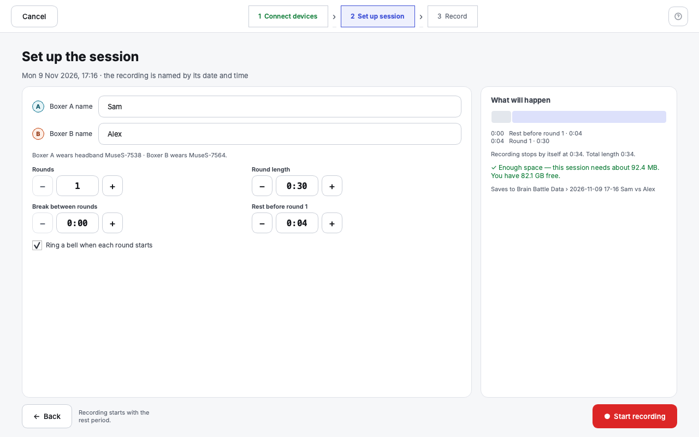
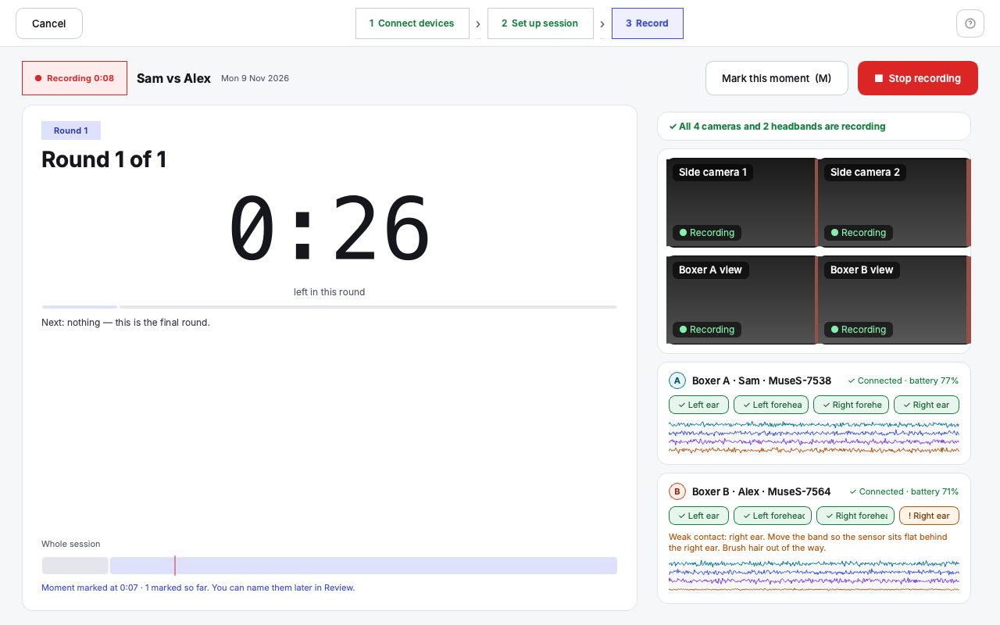
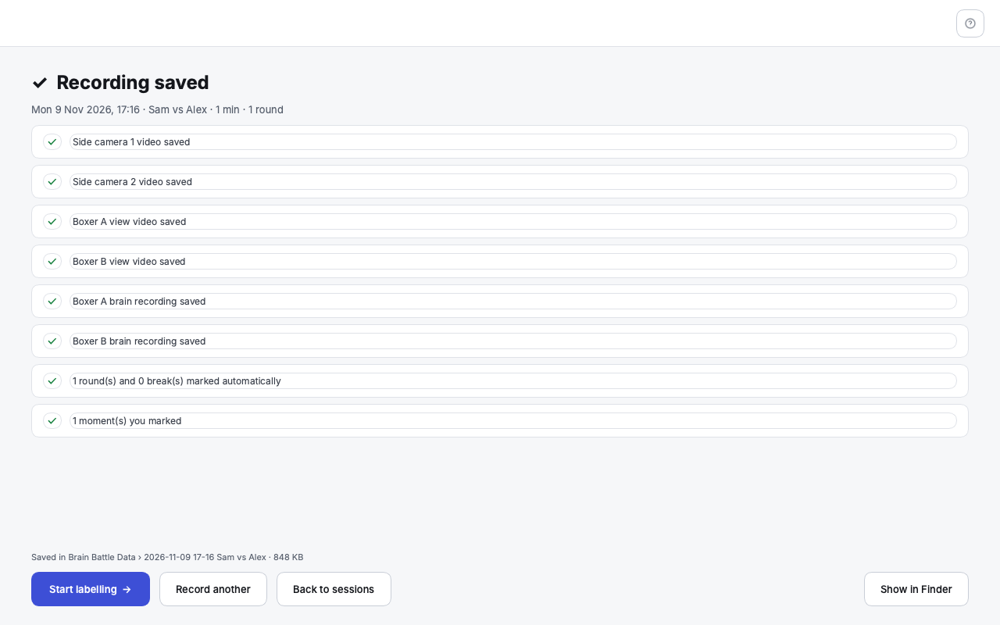

# New recording

**What this page covers:** all four steps of the guided recording flow —
Connect devices, Set up session, Recording, and Saved — and what to do when
a camera is missing or a headband disconnects.

Press **New recording** from Sessions (or the sidebar) to start. The flow is
full-screen with no sidebar, a **Cancel** button, and a 3-step indicator
(Connect devices → Set up session → Record) across the top.

## Step 1 — Connect devices

"Connect the cameras and headbands" / "Plug in the cameras and switch both
headbands on. When everything shows a green tick, you are ready."

- **Cameras** — four tiles (Side camera 1, Side camera 2, Boxer A view,
  Boxer B view), each with a live preview, a ✓/! status icon, and a
  **Change** button if you need to pick a different device. A tile with a
  red border means that camera wasn't found.
- **Headbands** — one block per boxer showing the device name, connection
  status, battery, and four sensor chips (Left ear, Left forehead, Right
  forehead, Right ear), each "Good contact" or "Weak contact." A weak
  sensor shows a plain-language tip for fixing it (e.g. "Move the band so
  the sensor sits flat against the skin behind the left ear. Brush hair out
  of the way.").
- The bottom bar totals it up: "N of 6 devices ready." **Search again**
  re-scans; **Continue →** is allowed even with something missing — the
  summary tells you plainly what won't be recorded if you continue anyway.

**If a camera shows "Not found":** check the USB cable and the video
receiver, then press **Search again**. **If a headband won't connect:**
make sure it's switched on and nearby, then **Search again**; a headband
that connects partway through and then drops shows a **Reconnect** button
in Step 3 (see below) rather than failing the whole recording.

## Step 2 — Set up session

- The recording's date/time is shown read-only — "the recording is named by
  its date and time."
- **Boxer A name** / **Boxer B name** — optional text fields; a note under
  them shows which headband each boxer is wearing (from
  [Settings](settings.md)).
- Four steppers — **Rounds**, **Round length**, **Break between rounds**,
  **Rest before round 1** — pre-filled from your session defaults in
  Settings, adjustable per recording with − / +.
- **"Ring a bell when each round starts"** checkbox.
- The right-hand card, "What will happen," shows a proportional phase bar,
  every phase with its start time, the total length, a disk-space check
  ("Enough space — this session needs about 1.7 GB. You have 412 GB free,"
  or a warning/blocking message if space is tight), and exactly where the
  recording will save to.
- **Start recording** is red and disabled if there truly isn't enough disk
  space; a low-but-workable amount of space asks you to confirm instead of
  blocking you outright.

## Step 3 — Recording

- A red "● Recording" pill with the elapsed time, the boxers' names, and
  the date, plus **Mark this moment (M)** and **■ Stop recording**.
- The main card shows the current phase, a large countdown, what's coming
  next ("Next: Break, 1 min · the bell rings when round 3 starts"), and a
  whole-session phase bar with a marker for where you are now.
- The side panel shows a health line ("✓ All 4 cameras and 2 headbands are
  recording," or exactly what's wrong), small camera previews, and each
  boxer's headband with a live trace and contact quality.

**Marking a moment:** press **M** or the **Mark this moment** button at any
time. It shows "Moment marked at 05:12 · 3 marked so far. You can name them
later in Review." — moments don't need a label on the spot; they show up in
[Review & Label](review-and-label.md) afterwards as unnamed labels ready to
be named.

**Stopping early:** **■ Stop recording** asks inline — "Stop recording now?
Round 2 is still running. Everything recorded so far is kept, but the rest
of the session will not happen." — with **Keep recording** / **Stop and
save**. Nothing already recorded is lost either way.

**If a headband disconnects mid-recording:** a **Reconnect** button appears
on that boxer's row. Pressing it resumes the SAME brain recording (it
appends to the same file, it doesn't start a new one) — the gap while it
was disconnected just has no data for that span.

## Step 4 — Saved

A checklist of what was recorded: the four camera videos (and whether any
lost frames), both brain recordings, rounds and breaks (marked
automatically — no action needed), how many moments you marked, and a
**"Worth checking"** section for anything that might need a second look
(for example, weak headband contact for part of a round). Exactly where it
saved to and its total size are shown at the bottom.

Three ways forward: **Start labelling →** (opens the recording directly in
[Review & Label](review-and-label.md)), **Back to sessions**, or **Record
another**.
