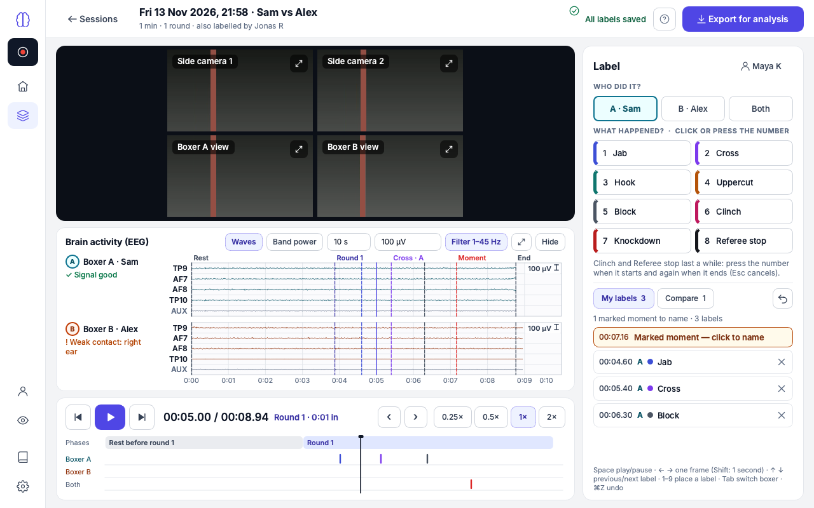
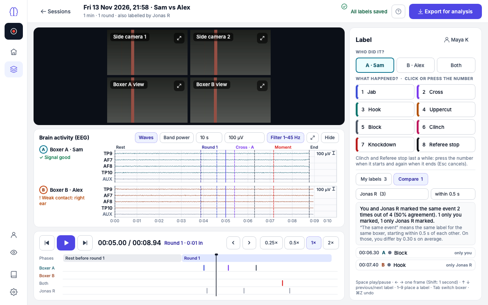

# Review & Label

**What this page covers:** watching a recording back and marking what happened
in it — and, when more than one person labels the same recording, comparing
your labels with theirs.

Open a recording from **Sessions**. Your labels and the timeline appear at
once; the videos and brain activity follow a moment later.

## Who is labelling

The first time you open Review & Label the panel on the right asks **"Who is
labelling?"**. Type your name and press **Start labelling**. You are asked only
once; the name appears at the top of the panel and in the sidebar, and you can
change it in [Settings](settings.md).

Your name matters because **every labeller's labels are kept separately**. Your
labels are saved in your own file inside the recording's folder, so two people
can label the same recording — even at the same time, on two computers sharing
one recordings folder — without overwriting each other. Use the same name on
every computer you label on.

## The screen

- **Top bar** — **Sessions** goes back to the list. The title says which
  recording this is. "All labels saved" confirms that everything you have done
  is on disk — there is no Save button. **Export for analysis** makes the files
  for analysis (see [Export](export.md)).
- **Videos** — the four cameras, always showing the same instant. The button in
  the corner of a picture makes that camera fill the area; press it again for
  all four.
- **Brain activity (EEG)** — both boxers' brain activity around the current
  moment, as a standard EEG display. **Hide** folds it away to give the videos
  more room; **Show** brings it back. See
  [Brain activity (EEG)](#brain-activity-eeg) below.
- **Transport and timeline** — always visible under the videos.
  - Back one frame · play/pause · forward one frame, then the time and the
    current phase ("Round 2 · 0:12 in").
  - **‹** and **›** jump to the previous and next label.
  - **Speed**: 0.25×, 0.5×, 1×, 2×.
  - The timeline shows the whole recording: a **Phases** row (rest, rounds,
    breaks — set automatically during recording), then your labels in three
    rows: **Boxer A**, **Boxer B**, **Both**. A short line is a moment; a bar is
    something that lasted a while. Click or drag anywhere to move; clicking
    near a label lands exactly on it.
- **Label panel** — on the right; described next.

## Placing a label

1. **Who did it?** Choose Boxer A, Boxer B or Both (or press **Tab** to switch).
2. **What happened?** Click a label or press its number (1–9). It is placed at
   the moment the video is showing.

Labels that **last a while** (Clinch and Referee stop in the starting list):
press the number when it starts and again when it ends. Between the two presses
a note reminds you which label is open; **Esc** cancels it.

Slow the video down (0.5× or 0.25×) or step frame by frame to place a label
precisely.

## My labels

The **My labels** tab lists what you have placed, newest first: time, boxer,
label. Click a row to jump to it; the **✕** on a row removes it. The **undo**
button (or ⌘Z on a Mac, Ctrl+Z on Windows) takes back your last change; with
Shift it redoes it.

**Marked moments.** Moments marked with **M** during recording appear at the top
of the list as "Marked moment — click to name". Click one, choose who and what,
and it becomes a normal label of yours. The mark stays in the recording, so
each labeller names it for themselves.

**Labels from before the app asked for names.** If a recording was labelled with
an older version of the app, a note says so. If you placed those labels, press
**These are mine** to take them over. Otherwise leave them; they stay available
for comparison.

## Comparing with another labeller

When someone else has also labelled the recording, the top bar says "also
labelled by …" and the **Compare** tab shows a number. Open it to:

- choose **whose labels** to compare with yours;
- see them on the timeline in an extra grey row under your own — always grey,
  never in a label colour, so they cannot be mistaken for yours;
- read **how far you agree**, in a sentence: "You and Jonas R marked the same
  event 18 times out of 24 (75% agreement). 4 only you marked, 2 only Jonas R
  marked."
- see the list of **differences** — each label only one of you placed. Click
  one to jump there and look again.

Two labels count as **the same event** when they are the same label, for the
same boxer, and start within half a second of each other. You can change "within
0.5 s" to 0.25, 1 or 2 seconds. For labels that last a while, overlapping also
counts.

You can never change another person's labels from here. If they are labelling
right now on another computer, their new labels appear here within a few
seconds.

## Brain activity (EEG)

The brain-activity card is a conventional EEG viewer: one trace per sensor,
named with the standard electrode names — TP9 (left ear), AF7 (left forehead),
AF8 (right forehead), TP10 (right ear), and AUX (the spare input) — in
microvolts, with a scale bar and a time axis. The current moment is the line in
the middle. Dashed lines mark round starts, marked moments and your labels.

- **Waves / Band power** — the traces, or how strong each brain rhythm is.
- **Timebase** — how many seconds fit across (2 to 30).
- **Scale** — how many microvolts the scale bar stands for, or Auto.
- **Filter 1–45 Hz** — tidies the display only; the recording is never changed.
  Switch it off to see the raw signal.
- The arrows button makes the display taller; **Hide** folds it away.

Under each boxer's name a line says "Signal good" or, for example, "Weak
contact: right ear" at that moment.

## Keyboard

| Key | Does |
|---|---|
| Space | Play / pause |
| ← → | One frame back / forward (with Shift: one second) |
| ↑ ↓ | Previous / next label |
| 1–9 | Place that label |
| Tab | Switch boxer (A → B → Both) |
| Esc | Cancel a label that is waiting for its end |
| ⌘Z / Ctrl+Z | Undo (with Shift: redo) |

## If labels can't be saved

If the recordings folder is on a drive that goes away while you are labelling,
the top bar turns red: "Not saved — the recordings folder can't be reached."
Keep the window open. Your labels are held in memory and saved by themselves as
soon as the drive is back.
