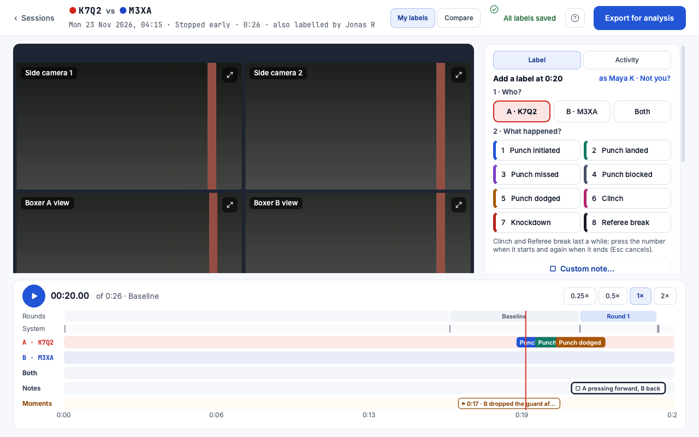
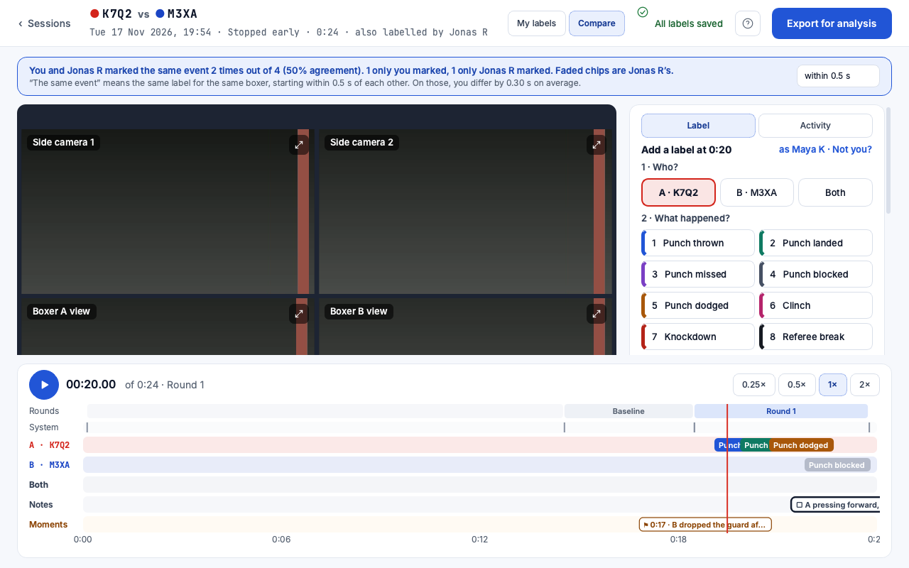

# Review & Label

**What this page covers:** watching a recording back and marking what happened
in it — labels, custom notes, the notes on marked moments — and, when more than
one person labels the same recording, comparing your labels with theirs.

Open a recording from **Sessions**. Your labels and the timeline appear at
once; the videos and brain activity follow a moment later.

## Who is labelling

The first time you label, the app asks **"Who is labelling?"**. Type your name;
you are asked only once on this computer, and you can change it in
[Settings](settings.md) (or **Not you?** in the panel). Only labellers have
names — fighters are always their codes.

**Every labeller's labels are kept separately**, in your own file inside the
recording's folder, so two people can label the same recording — even at the
same time, on two computers sharing one recordings folder — without overwriting
each other. Use the same name on every computer.

## The screen

- **Header** — **‹ Sessions** goes back. The title shows the two fighters
  (`● K7Q2 vs ● M3XA`), the date and the length. **My labels / Compare**
  appears when someone else has labelled too. "✓ All labels saved" confirms
  everything is on disk — there is no Save button. **Export for analysis** (see
  [Export](export.md)).
- **Cameras** — the four cameras, always at the same instant. The button in a
  picture's corner makes it fill the area; press again for all four.
- **The panel on the right** — **Label** (described below) and **Activity**
  (the recording's history).
- **Brain activity (EEG)** — both boxers around the current moment. See
  [Brain activity (EEG)](#brain-activity-eeg).
- **Transport** — back a frame · play/pause · forward a frame, the time ("3:27
  of 12:15 · Round 2"), and the speed (0.25×, 0.5×, 1×, 2×).
- **Lanes** — the whole recording, one row each: **Rounds** (lead-in,
  baseline, rounds, breaks); **System** (a grey tick for every automatic marker
  — click one to see, for example, `ROUND_2_START · 05:15.00`); **A · K7Q2**,
  **B · M3XA** and **Both** (your labels; a short line is a moment, a bar lasts
  a while); **Notes** (custom notes); **Moments** (the moments marked while
  recording, ⚑). Click or drag anywhere to move.

## Placing a label

The panel says "Add a label at 3:27".

1. **Who did it?** — **A · K7Q2**, **B · M3XA** or **Both** (Tab switches).
2. **What happened?** — click a label or press its number (1–8). It is placed
   at the moment the video shows. The starting list is Punch thrown, Punch
   landed, Punch missed, Punch blocked, Punch dodged, Clinch, Knockdown and
   Referee break; the team can change it in [Settings](settings.md).

Labels that **last a while** (Clinch, Referee break): press the number when it
starts and again when it ends; **Esc** cancels. Slow the video down or step
frame by frame to be precise. Click a label on the lanes to select it;
**Delete** removes it. **Undo** (⌘Z on a Mac, Ctrl+Z on Windows; with Shift it
redoes).

## Custom notes

For something the label list does not cover, press **Custom note…** (or **N**):
choose who, type what you saw, and press **Add note**. A note sits on the
**Notes** lane at that moment. Notes never become part of the label list and
are not counted when comparing labellers; they are exported with your labels
(`labels.csv`, column `text`).

## Moments marked while recording

Moments marked with **M** during the recording are on the **Moments** lane.
Click one: the panel shows "Moment at 3:27" with the observer's note — write or
correct it (it saves as you type) — and the label list, to put one of your
labels at exactly that instant. While any moment still has no note the panel
says, for example, "2 marked moments have no note yet", and the recording stays
*Needs labels* in Sessions.

**Labels from before the app asked for names.** If a recording was labelled with
an older version, a note says so; press **These are mine** if you placed them.

## Comparing with another labeller

When someone else has also labelled the recording, the top bar says "also
labelled by …" and the **Compare** tab shows a number. Open it to:

- choose **whose labels** to compare with yours;
- see them on the timeline in an extra grey row under your own — always grey,
  never in a label colour, so they cannot be mistaken for yours;
- read **how far you agree**, in a sentence: "You and Jonas R marked the same
  event 18 times out of 24 (75% agreement). 4 only you marked, 2 only Jonas R
  marked."
- see the list of **differences** — each label only one of you placed. Click
  one to jump there and look again.

Two labels count as **the same event** when they are the same label, for the
same boxer, and start within half a second of each other. You can change "within
0.5 s" to 0.25, 1 or 2 seconds. For labels that last a while, overlapping also
counts.

You can never change another person's labels from here. If they are labelling
right now on another computer, their new labels appear here within a few
seconds.

## Brain activity (EEG)

The brain-activity card is a conventional EEG viewer: one trace per sensor,
named with the standard electrode names — TP9 (left ear), AF7 (left forehead),
AF8 (right forehead), TP10 (right ear), and AUX (the spare input) — in
microvolts, with a scale bar and a time axis. The current moment is the line in
the middle. Dashed lines mark round starts, marked moments and your labels.

- **Waves / Band power** — the traces, or how strong each brain rhythm is.
- **Timebase** — how many seconds fit across (2 to 30).
- **Scale** — how many microvolts the scale bar stands for, or Auto.
- **Filter 1–45 Hz** — tidies the display only; the recording is never changed.
  Switch it off to see the raw signal.
- The arrows button makes the display taller; **Hide** folds it away.

Under each boxer's name a line says "Signal good" or, for example, "Weak
contact: right ear" at that moment.

## Keyboard

| Key | Does |
|---|---|
| Space | Play / pause |
| ← → | One frame back / forward (with Shift: one second) |
| ↑ ↓ | Previous / next label |
| 1–9 | Place that label (the list's first nine) |
| N | Custom note |
| Delete | Remove the selected label |
| Tab | Switch boxer (A → B → Both) |
| Esc | Cancel a label that is waiting for its end |
| ⌘Z / Ctrl+Z | Undo (with Shift: redo) |

## If labels can't be saved

If the recordings folder is on a drive that goes away while you are labelling,
the top bar turns red: "Not saved — the recordings folder can't be reached."
Keep the window open. Your labels are held in memory and saved by themselves as
soon as the drive is back.
