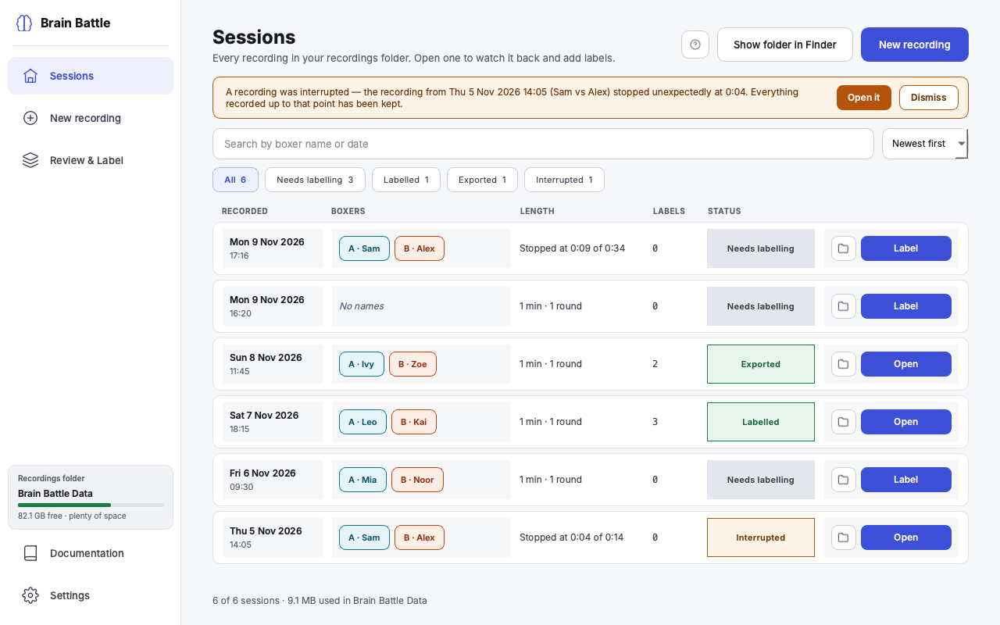

# Sessions

**What this page covers:** the home screen — finding, filtering, and opening
past recordings, and what the interrupted-recording banner means.

Sessions is where the app opens. The subtitle sums it up: "Every recording
in your recordings folder. Open one to watch it back and add labels."

## Finding a recording

- **Search** — "Search by boxer name or date," matches either boxer's name
  or the recording's date.
- **Status filter chips** — All, Needs labelling, Labelled, Exported,
  Interrupted — each shows a live count.
- **Sort** — Newest first or Oldest first.

## What the table shows

| Column | Meaning |
|---|---|
| Recorded | Date (bold) and time the recording started |
| Boxers | Boxer A and Boxer B's names, in their colours |
| Length | "12 min · 3 rounds" for a complete recording, or "Stopped at 9:41 of 12:00" if it was stopped early |
| Labels | How many labels have been placed so far |
| Status | See the table below |
| (actions) | A folder icon to show the recording in Finder, and an Open/Label button |

A recording made with practice/demo data (not a real capture) carries a small
**Demo** badge next to the boxer names, so it's never mistaken for a real
session.

## Status meanings

| Status | When it's shown |
|---|---|
| **Interrupted** | The app didn't shut the recording down cleanly (e.g. a crash or power loss) — see below |
| **Needs labelling** | The recording has zero labels placed yet |
| **Labelled** | At least one label has been placed |
| **Exported** | An analysis export already exists for this recording |

## If a recording was interrupted

If Brain Battle didn't close a recording cleanly last time (a crash, the
laptop losing power, and so on), the next time you open the app Sessions
shows a banner:

> A recording was interrupted — The recording from \<date, time\>
> (\<Boxer A\> vs \<Boxer B\>) stopped unexpectedly at \<m:ss\>. Everything
> recorded up to that point has been kept.

with **Open it** and **Dismiss** buttons. Nothing is lost — every camera
file and brain recording up to the moment it stopped is intact and
reviewable. **Dismiss** just stops the banner reappearing for that
recording; it doesn't delete anything. See
[Troubleshooting](troubleshooting.md) if you want to know what causes an
interrupted recording.

## Footer

At the bottom: "\<n\> of \<m\> sessions · \<size\> used in \<folder name\>"
— a running total so you can keep an eye on disk usage without leaving the
screen.

## Starting a new recording

Press **New recording** (top right) to begin the
[guided recording flow](new-recording.md).
