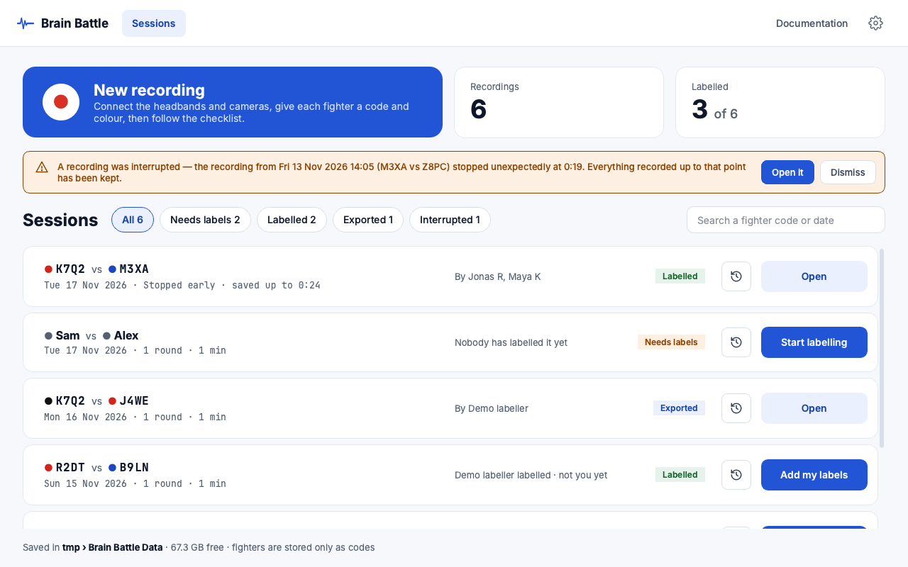

# Sessions

**What this page covers:** the Sessions screen — every recording in your
recordings folder, and the place the app opens on.

## What you see

- **● New recording** — the big blue button. It opens [New recording](new-recording.md).
- **Recordings** — how many recordings the folder holds. **Labelled** — how
  many of them are labelled or exported ("3 of 6").
- **Status pills** with a count on each: All, Needs labels, Labelled, Exported,
  Interrupted. Click one to show only those recordings.
- **Search a fighter code or date** — type a code (`K7Q2`), part of one, a
  date, or a labeller's name.
- **One card per recording:**
  - the two fighters as their codes, each with a dot in the colour they wore
    (`● K7Q2 vs ● M3XA`);
  - the date and the length ("3 rounds · 12 min", or "Interrupted · saved up to
    6:27");
  - a progress line — for example "You: 4 labels, 1 moment without a note",
    "Nobody has labelled it yet" or "Maya K labelled · not you yet";
  - the status;
  - **⟲ History** — who labelled it and everything that happened to it;
  - the button for **your** next step: **Start labelling**, **Continue
    labelling**, **Add my labels** or **Open**.
  - Right-click a card for **Export for analysis…** (without opening it) and
    **Show in Finder** (Mac) / **Show in Explorer** (Windows).
- The line at the bottom names the folder, its free space, and reminds you that
  fighters are stored only as codes.

## What each status means

| Status | Meaning |
|---|---|
| Needs labels | Nobody has placed a label yet, **or** a moment marked while recording still has no note. |
| Labelled | Labels are placed and every marked moment has a note. |
| Exported | It has been exported for analysis at least once. |
| Interrupted | The recording did not reach its end: a crash or power cut, or someone left with ✕ Cancel or quit the app while recording. Everything up to that moment was kept. |
| Can't be opened | The folder's details could not be read. The files are still there. |

## The history drawer

**⟲** slides a panel in from the right (click outside it or **×** to close):
the two fighters, each labeller with how many
labels they placed, and every event — recorded, moments marked, labels added and
removed, notes written, exported, a camera that was reconnected — newest first.
It is saved with the recording, so everyone sees the same history.

## When something needs attention

- **"A recording was interrupted"** — a yellow banner names it. **Open it** to
  look at what was recorded; **Dismiss** hides the banner for good (the
  recording stays).
- **"The recordings folder can't be reached"** — the drive is not connected.
  Connect it and press **Try again**, or choose another folder in
  [Settings](settings.md).
