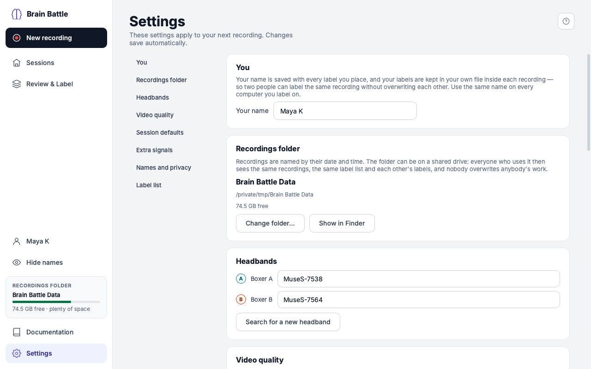

# Settings

**What this page covers:** every section of the Settings screen and what
each one controls. Everything here autosaves immediately — there's no Save
button — and applies to your **next** recording, not one already in
progress.

The list on the left jumps to each section.

## You

**Your name** — who is labelling on this computer. It is saved with every label
you place, and your labels are kept in your own file inside each recording, so
several people can label the same recording without overwriting each other.
Use the same name on every computer you label on; names that differ only in
capitals or spacing count as the same person. There are no accounts or
passwords — it is simply a name. The sidebar shows it on every screen.

## Recordings folder

Shows the folder's name, full path, and free space. By default this is a
**Brain Battle Data** folder inside your **Documents** folder. **Change
folder…** picks an existing folder or lets you create a new one; **Show in
Finder** (Mac) / **Show in Explorer** (Windows) opens it. Recordings already in
the old folder are **not** moved — you're only changing where new ones go.

**A shared folder.** The folder can be on a shared drive that several computers
use — Macs and Windows PCs alike. Everyone pointed at it sees the same
recordings, the same label list and each other's labels, and nobody overwrites
anybody's work, because each labeller's labels are stored separately. The card
says "on a shared (network) drive" when it recognises one. Two things to know:

- **Label on the shared drive; record to this computer if you can.** Recording
  four videos straight onto a network drive can lose video if the connection
  drops. It is safer to record into a folder on the computer and copy the
  finished recording's folder to the shared drive afterwards. The Get ready
  screen reminds you when the folder is on a network drive.
- If the drive is not connected, the app says "The recordings folder can't be
  reached" rather than showing an empty list. Reconnect it and press
  **Try again** in Sessions.

If the `BRAIN_BATTLE_CAPTURE_DIR` environment variable is set, the folder
path is shown with a note that it's set outside the app, and **Change
folder…** is turned off — an administrator-level override always wins over
a folder picked here.

## Headbands

A dropdown per boxer (**Boxer A**, **Boxer B**) listing every headband
Brain Battle has seen before, plus **Search for a new headband** to scan
for one nearby. The same headband can't be assigned to both boxers — trying
to shows an inline message and the change is rejected.

## Video quality

Three options, each showing its resolution/frame rate and an "about X GB
per hour per camera" estimate computed from its actual recording bitrate
(not a fixed number — it updates if the quality level's bitrate ever
changes):

| Option | Resolution | Notes |
|---|---|---|
| **Standard** | 960×540, 30 fps | Recommended; selected by default |
| **High** | 1280×720, 30 fps | Larger files, sharper video |
| **Light** | 640×360, 30 fps | Smallest files |

## Session defaults

Four steppers — **Rounds**, **Round length**, **Break between rounds**,
**Rest before round 1** — plus **"Ring a bell when each round starts"** and
a **Test sound** button that plays the actual bell: a real boxing-bell
recording (one clean strike with its natural ring, about two seconds), not a
synthesized tone. When it's on, it rings once at the start of the rest
before round 1 and once at the start of each round — never during a break.
These pre-fill the Set up step of every [new recording](new-recording.md);
each recording can still adjust them for that session only.

## Extra signals and sharing

Three switches:

- **Record head movement (the headband's motion sensors)** — on by default.
  Saves each headband's movement next to its brain recording, which later helps
  tell "the boxer moved" apart from "the brain did something".
- **Record pulse (the headband's optical sensor)** — off by default. It has
  not been tried with real headbands yet; if the headbands stop connecting
  reliably after you switch it on, switch it off again.
- **Share live signals with other lab software on this network** — on by
  default. While the New recording screens are open, other programs that speak
  *Lab Streaming Layer* (LabRecorder, EEG viewers) can see the headbands, the
  round markers and the camera timing. Your recordings are saved exactly the
  same whether this is on or off. The first time, your computer may ask whether
  to allow incoming network connections — either answer is fine for recording.

## Boxer names and privacy

Boxer names are kept with each recording, in its analysis file
(`recording.xdf`) and in exports, so the team can keep track of who is who.
Two switches hide them where you don't want them:

- **Replace boxer names with Boxer A / Boxer B in exports** — sets what the
  export window starts with; you can still choose for each export. A name-free
  export has no names in its files or its file name.
- **Hide boxer names on screen** — shows "Boxer A" and "Boxer B" instead of
  names in Sessions and Review & Label, for presenting or sharing your screen.
  The same switch is in the sidebar (**Hide names**), and on the keyboard:
  ⇧⌘H on a Mac, Ctrl+Shift+H on Windows.

Neither switch changes a recording on disk, and neither hides the boxers'
faces in the videos. See the
[Personal data note](../research-and-data/personal-data.md).

## Label list

The labels offered in Review & Label — one list for the whole team, stored in
the recordings folder so everyone sharing the folder has the same one. Each
row: the number key that places it, its colour, its name, and whether it is a
**Moment** or **Lasts a while**. Use ↑ ↓ to reorder (the order is the number
keys 1–9), ✕ to remove, and **+ Add label** to add one. Removing a label from
the list never removes labels that were already placed.

## Footer

"Brain Battle \<version\> · Constructor University."
