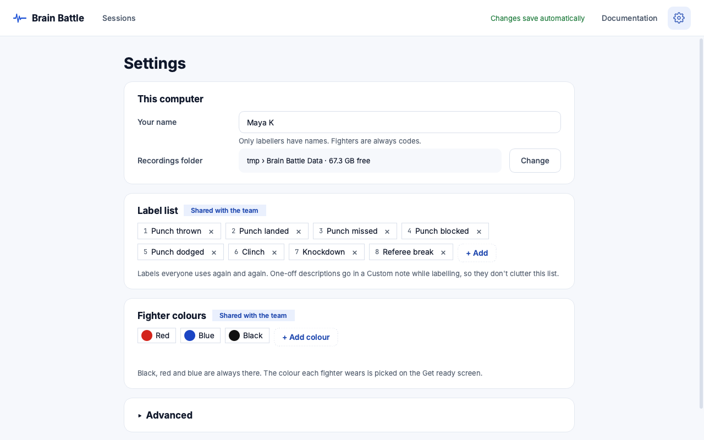

# Settings

**What this page covers:** every part of the Settings screen. Changes save
automatically ("Changes save automatically" in the header) and apply to your
**next** recording, not one in progress.

## This computer

**Your name** — who is labelling on this computer. It is saved with every label
you place, and your labels are kept in your own file in each recording, so
several people can label the same recording without overwriting each other.
Use the same name on every computer; names that differ only in capitals or
spacing count as the same person. There are no accounts. Only labellers have
names — fighters are always codes.

**Recordings folder** — where recordings are saved, with its free space. By
default **Brain Battle Data** in your **Documents** folder. **Change** picks
another; recordings already in the old folder are not moved. If the
`BRAIN_BATTLE_CAPTURE_DIR` environment variable is set, the folder is shown with
a note that it is set outside the app and cannot be changed here.

**A shared folder.** The folder can be on a shared drive used by several
computers — Macs and Windows PCs alike. Everyone pointed at it sees the same
recordings, the same label list and colours, and each other's labels, and
nobody overwrites anybody's work. Two things to know:

- **Label on the shared drive; record to this computer if you can.** Recording
  four videos straight onto a network drive can lose video if the connection
  drops. Get ready reminds you when the folder is on a network drive.
- If the drive is not connected, the app says "The recordings folder can't be
  reached" rather than showing an empty list. Reconnect it and press **Try
  again** in Sessions.

## Label list — shared with the team

The labels offered in Review & Label, one list for everyone sharing the
recordings folder (`label_vocabulary.json` in that folder). Each chip is a
label; **×** removes it, **+ Add** adds one (type the name, press Enter). The
order is the number keys 1–8. Removing a label never removes labels already
placed. One-off descriptions belong in a **Custom note** while labelling, not in
the list. A new team starts with Punch thrown, Punch landed, Punch missed,
Punch blocked, Punch dodged, Clinch, Knockdown and Referee break; a team that
already has a list keeps it.

## Fighter colours — shared with the team

Each fighter wears a colour, picked on **Get ready** next to their code. Red,
Blue and Black are always there. **+ Add colour** adds another (a colour and a
name) for the whole team, kept in the recordings folder
(`fighter_colours.json`). See the
[Personal data note](../research-and-data/personal-data.md).

## Advanced

Folded away by default:

- **Record head movement** — on. Saves each headband's motion sensors next to
  its brain recording; this helps tell "the boxer moved" from "the brain did
  something", and the buzzer test uses it to find the taps.
- **Record pulse** — off. Not yet tried with real headbands; if the headbands
  stop connecting reliably after switching it on, switch it off.
- **Record cameras at 60 fps** — on. Finer timing (one frame every 17 ms
  instead of 33 ms), at the cost of larger files. A camera that cannot do
  60 fps records at 30 and the app says so.
- **Send live signals to other programs (LSL)** — off. The app shows
  everything live without it. Switch it on only if another program
  (LabRecorder, an EEG viewer) should receive the headbands, markers and camera
  times while you record. Recordings are saved the same either way.
- **Which headband each boxer wears** — a list per boxer of every headband
  seen before, plus **Search for a new headband**. The same headband can't be
  given to both boxers. (On Get ready, **⇄ Swap the headbands** swaps them.)
- **Video quality** — Standard (960×540, recommended), High (1280×720) or
  Light (640×360), each with how much space an hour takes per camera.

The plan (rounds, round length, break, baseline) and the bell are set on Get
ready and remembered for next time.
